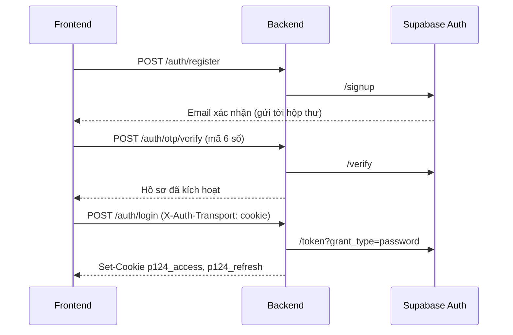

# API Xác thực & Người dùng — VCare+ (P-124)

> Các endpoint `/auth/*`, `/users/*`, `/patients/me`. Base URL: `/api/v1`.
> Căn cứ: `src/api/endpoints/auth.py`, schema `src/schemas/auth.py`, dịch vụ `src/services/supabase_auth.py` (develop `42c909e`).
> Định dạng phản hồi và lỗi chung: xem [README.md](README.md).

## Cơ chế tổng quát

- **Nhà cung cấp danh tính duy nhất là Supabase Auth** (`AUTH_PROVIDER=supabase`). Backend chuyển các yêu cầu đăng ký, xác nhận, đăng nhập, làm mới token, khôi phục mật khẩu tới Supabase (`SUPABASE_URL/auth/v1`). Bảng `users` của hệ thống chỉ lưu **hồ sơ ứng dụng** (vai trò, thông tin cá nhân, hồ sơ sức khỏe).
- **Chỉ đăng ký và đăng nhập bằng email + mật khẩu.** Số điện thoại chỉ là thông tin hồ sơ.
- **Xác nhận tài khoản bằng email:** Supabase gửi email chứa mã/liên kết xác nhận. Tài khoản chưa xác nhận thì không đăng nhập được.
- **Tài khoản đăng ký mới luôn là bệnh nhân** (`role = "patient"`). Tài khoản staff được cấp riêng, không đăng ký qua API này.



## Danh sách endpoint

| Method | Path | Quyền | Mục đích |
|---|---|---|---|
| POST | `/auth/register` | Công khai | Đăng ký tài khoản |
| POST | `/auth/otp/send` | Công khai | Gửi lại email xác nhận |
| POST | `/auth/otp/verify` | Công khai | Xác nhận email bằng mã OTP |
| POST | `/auth/login` | Công khai | Đăng nhập |
| POST | `/auth/refresh-token` | Công khai (cần refresh token) | Làm mới phiên |
| POST | `/auth/logout` | Công khai | Đăng xuất |
| POST | `/auth/forgot-password` | Công khai | Gửi email khôi phục mật khẩu |
| POST | `/auth/reset-password` | Công khai | **Ngừng dùng**, luôn trả 400 |
| PUT | `/auth/password` | Đăng nhập | Đổi mật khẩu |
| GET | `/users/me` | Đăng nhập | Xem hồ sơ của mình |
| GET | `/patients/me` | Đăng nhập | Giống `/users/me` |
| PATCH | `/users/me` | Bệnh nhân | Cập nhật hồ sơ |
| GET | `/users/me/portrait` | Đăng nhập | Lấy ảnh hồ sơ |
| PATCH | `/users/me/portrait` | Bệnh nhân | Cập nhật / xóa ảnh hồ sơ |
| GET | `/users/{user_id}` | Staff | Xem hồ sơ một người dùng |

---

## POST `/auth/register`: Đăng ký

**Request body** (`RegisterRequest`)

| Trường | Kiểu | Bắt buộc | Ràng buộc |
|---|---|---|---|
| `email` | string | **Có** (thực tế) | 3–320 ký tự, đúng định dạng email; Gmail: phần tên 6–30 ký tự, chỉ chữ/số/dấu chấm |
| `password` | string | **Có** (thực tế) | 8–128 ký tự |
| `full_name` | string | Không | 2–200 ký tự sau khi bỏ khoảng trắng |
| `phone` | string | Không | Số di động Việt Nam (`0` hoặc `+84` + đầu số hợp lệ + 7 số) |
| `date_of_birth` | date | Không | Trong quá khứ, tuổi ≤ 150 |
| `gender` | enum | Không | `male` / `female` / `other` / `unspecified` |
| `citizen_id` | string | Không | Đúng 12 chữ số |
| `health_insurance_code` | string | Không | 1–32 ký tự |
| `address` | string | Không | Tối đa 500 ký tự |

Schema cho phép gửi `phone` thay `email`, nhưng dịch vụ đăng ký **bắt buộc email + mật khẩu**, thiếu thì trả `EMAIL_REQUIRED`.

```json
{
  "email": "nguyenvanan@gmail.com",
  "password": "MatKhau@123",
  "full_name": "Nguyễn Văn An",
  "phone": "0912345678",
  "date_of_birth": "1990-05-20",
  "gender": "male"
}
```

**Response `201`**

```json
{
  "timestamp": "2026-10-10T09:30:00Z",
  "error": null,
  "message": "Vui lòng kiểm tra email để xác nhận tài khoản.",
  "status": 201,
  "data": { "confirmation_required": true, "email": "nguyenvanan@gmail.com" }
}
```

Hồ sơ được tạo với `role = "patient"`, `status = "pending_verification"`.

**Lỗi thường gặp**

| HTTP | `error_code` | Khi nào |
|---|---|---|
| 400 | `VALIDATION_ERROR` | Body sai ràng buộc (số điện thoại, ngày sinh, CCCD…) |
| 400 | `EMAIL_REQUIRED` | Không có email hoặc mật khẩu |
| 409 | `PHONE_EXISTS` / `CITIZEN_ID_EXISTS` / `HEALTH_INSURANCE_EXISTS` | Số điện thoại / CCCD / thẻ BHYT đã thuộc hồ sơ khác |
| 409 | `PROFILE_BOUND` | Hồ sơ đã liên kết với tài khoản khác |
| 4xx | `email_exists`, `user_already_exists` | Email đã đăng ký (mã của Supabase) |
| 4xx | `email_address_invalid` | Supabase từ chối địa chỉ email |
| 429 | `over_email_send_rate_limit` | Gửi email quá nhiều lần |
| 503 | `AUTH_UNAVAILABLE` | Không kết nối được Supabase (đã tự thử lại 1 lần) |

---

## POST `/auth/otp/send`: Gửi lại email xác nhận

**Request body** (`OtpSendRequest`)

| Trường | Kiểu | Bắt buộc | Ghi chú |
|---|---|---|---|
| `email` | string | **Có** (thực tế) | Thiếu email → 400 "Vui lòng sử dụng email để xác thực." |
| `phone` | string | Không | Không dùng |
| `purpose` | enum | Không | `register` (mặc định) / `login` / `reset_password` |

```json
{ "email": "nguyenvanan@gmail.com", "purpose": "register" }
```

**Response `200`**: `data` là `{"otp": null}`, message "Email xác nhận đã được gửi". Mã OTP **không bao giờ** được trả trong response.

**Lỗi:** `400` thiếu email · `429 over_email_send_rate_limit` · `503 AUTH_UNAVAILABLE`.

---

## POST `/auth/otp/verify`: Xác nhận email

**Request body** (`OtpVerifyRequest` = `OtpSendRequest` + `code`)

| Trường | Kiểu | Bắt buộc | Ràng buộc |
|---|---|---|---|
| `email` | string | Có | |
| `code` | string | Có | Đúng 6 ký tự |
| `purpose` | enum | Không | Phải là `register` |

```json
{ "email": "nguyenvanan@gmail.com", "code": "482913", "purpose": "register" }
```

**Response `200`**: `data` là `UserResponse` (xem mục cuối), message "Đã xác nhận email. Vui lòng đăng nhập." Hồ sơ được kích hoạt.

**Lỗi**

| HTTP | `error_code` | Khi nào |
|---|---|---|
| 400 | `HTTP_ERROR` | Thiếu email hoặc `purpose` khác `register` |
| 4xx | `otp_expired` | Mã sai hoặc hết hạn |
| 401 | `EMAIL_NOT_CONFIRMED` | Supabase chưa ghi nhận xác nhận |
| 401 | `ACCOUNT_DISABLED` | Tài khoản không hoạt động |

---

## POST `/auth/login`: Đăng nhập

**Request body** (`LoginRequest`, không chấp nhận trường thừa)

| Trường | Kiểu | Bắt buộc | Ràng buộc |
|---|---|---|---|
| `email` | string | Có | 3–320 ký tự, tự chuyển chữ thường |
| `password` | string | Có | 8–128 ký tự |

```json
{ "email": "nguyenvanan@gmail.com", "password": "MatKhau@123" }
```

**Response `200`**: phụ thuộc header `X-Auth-Transport`:

- **Có `X-Auth-Transport: cookie`** (frontend web): backend đặt cookie `p124_access` (hết hạn theo `expires_in` của Supabase) và `p124_refresh` (30 ngày), body chỉ có:

```json
{ "message": "Success", "status": 200, "data": { "authenticated": true, "expires_in": 3600 } }
```

- **Không có header** (Postman, ứng dụng khác): token nằm trong body (`TokenResponse`):

```json
{
  "message": "Success",
  "status": 200,
  "data": {
    "access_token": "eyJhbGciOi...",
    "refresh_token": "v1.MRjQ...",
    "token_type": "bearer",
    "expires_in": 3600
  }
}
```

(`timestamp`, `error` lược bớt cho gọn.) `expires_in` tính bằng giây, do Supabase cấp.

**Lỗi**

| HTTP | `error_code` | Khi nào |
|---|---|---|
| 400 | `VALIDATION_ERROR` | Mật khẩu dưới 8 ký tự, có trường thừa… |
| 400 | `invalid_credentials` | Sai email hoặc mật khẩu ("Email hoặc mật khẩu không đúng.") |
| 400/401 | `email_not_confirmed` / `EMAIL_NOT_CONFIRMED` | Chưa xác nhận email |
| 401 | `ACCOUNT_DISABLED` | Tài khoản không hoạt động |
| 401 | `PROFILE_BOUND` | Hồ sơ đã liên kết với tài khoản khác |
| 503 | `AUTH_UNAVAILABLE` | Không kết nối được Supabase |

---

## POST `/auth/refresh-token`: Làm mới phiên

Lấy refresh token từ **cookie `p124_refresh`**, nếu không có thì lấy từ body:

```json
{ "refresh_token": "v1.MRjQ...(tối thiểu 32 ký tự)" }
```

**Response `200`**: giống `/auth/login` (cookie hoặc token trong body). Supabase **xoay vòng** refresh token: token cũ hết hiệu lực, client phải dùng token mới.

**Lỗi:** `401 UNAUTHORIZED` "Không có phiên đăng nhập để gia hạn." (không có refresh token) · lỗi refresh token từ Supabase. Khi lỗi `400/401/403` với cookie, backend **tự xóa cookie phiên**.

---

## POST `/auth/logout`: Đăng xuất

Không bắt buộc body; có thể gửi `{"refresh_token": "..."}` nếu không dùng cookie.

**Response `200`**: `data: null`, message "Logout successful". Cookie phiên **luôn bị xóa**, kể cả khi gọi Supabase lỗi.

---

## POST `/auth/forgot-password`: Khôi phục mật khẩu

```json
{ "email": "nguyenvanan@gmail.com" }
```

**Response `200`**: `data: {"otp": null}`, message "Nếu tài khoản tồn tại, liên kết khôi phục sẽ được gửi qua email." Thông báo **giống nhau** dù email có tồn tại hay không (không để lộ tài khoản nào đã đăng ký). Liên kết trong email dẫn tới trang `/forgot-password` của frontend.

**Lỗi:** `400` thiếu email · `429 over_email_send_rate_limit`.

---

## POST `/auth/reset-password`: Ngừng dùng

Schema vẫn nhận `email`, `code` (6 chữ số), `new_password` (8–128 ký tự), nhưng endpoint **luôn trả `400`** "Vui lòng mở liên kết khôi phục trong email." Việc đặt lại mật khẩu đi qua liên kết Supabase gửi trong email, sau đó dùng `PUT /auth/password`.

---

## PUT `/auth/password`: Đổi mật khẩu

**Quyền:** đã đăng nhập (token qua cookie hoặc `Authorization: Bearer`).

```json
{ "new_password": "MatKhauMoi@456" }
```

`new_password`: 8–128 ký tự.

**Response `200`**: `data: null`, message "Đã cập nhật mật khẩu. Vui lòng đăng nhập lại." Backend **kết thúc phiên hiện tại** và xóa cookie, nên người dùng phải đăng nhập lại.

---

## GET `/users/me` (và `/patients/me`): Xem hồ sơ

**Response `200`**: `data` là `UserResponse`:

```json
{
  "id": "6f1c2a0e-8b5d-4c1e-9a7f-2d3b4c5e6f70",
  "email": "nguyenvanan@gmail.com",
  "phone": "0912345678",
  "role": "patient",
  "status": "active",
  "full_name": "Nguyễn Văn An",
  "date_of_birth": "1990-05-20",
  "gender": "male",
  "citizen_id": null,
  "health_insurance_code": null,
  "patient_details": {
    "medical_history": [
      { "id": "1b2c3d4e-0000-4000-8000-000000000001", "name": "Tăng huyết áp", "status": "in_treatment" }
    ],
    "blood_type": "O+",
    "allergies": "Penicillin",
    "current_medications": null,
    "address": null,
    "emergency_name": "Nguyễn Thị B",
    "emergency_relationship": "Vợ",
    "emergency_phone": "0987654321",
    "systolic": 130, "diastolic": 85, "heart_rate": 72,
    "height_cm": 170, "weight_kg": 68, "blood_glucose": null
  }
}
```

Ảnh hồ sơ (`portrait_image`) **không** nằm trong response này. Dùng `GET /users/me/portrait`.

**Lỗi:** `401 NOT_AUTHENTICATED` (thiếu token) · `401 INVALID_TOKEN` · `503 AUTH_UNAVAILABLE`.

---

## PATCH `/users/me`: Cập nhật hồ sơ

**Quyền:** bệnh nhân. **Request body** (`UpdateProfileRequest`, không chấp nhận trường thừa, chỉ gửi trường cần đổi):

| Trường | Kiểu | Ràng buộc |
|---|---|---|
| `full_name` | string | Tối đa 200 ký tự |
| `phone` | string | `0` hoặc `+84` + đầu `3/5/7/8/9` + 8 số |
| `date_of_birth` | date | Trong quá khứ, tuổi ≤ 150 |
| `gender` | enum | `male` / `female` / `other` / `unspecified` |
| `citizen_id` | string | Đúng 12 chữ số |
| `health_insurance_code` | string | 1–32 ký tự |
| `patient_details` | object | Xem bảng dưới |

**`patient_details`** (`PatientDetails`, không chấp nhận trường thừa):

| Trường | Kiểu | Ràng buộc |
|---|---|---|
| `medical_history` | mảng `MedicalCondition` | Tối đa 100 mục; mỗi mục `{id: UUID, name: 1–200 ký tự, status: "recovered" \| "in_treatment"}` |
| `blood_type` | enum | `A+ A- B+ B- AB+ AB- O+ O-` |
| `allergies`, `current_medications` | string | Tối đa 2000 ký tự |
| `address` | string | Tối đa 500 ký tự |
| `emergency_name` | string | Tối đa 200 ký tự |
| `emergency_relationship` | string | Tối đa 100 ký tự |
| `emergency_phone` | string | Cùng định dạng `phone` |
| `systolic` | int | 40–300 (mmHg) |
| `diastolic` | int | 20–200 (mmHg) |
| `heart_rate` | int | 20–300 (nhịp/phút) |
| `height_cm` | number | 0–300 |
| `weight_kg` | number | 0–500 |
| `blood_glucose` | number | 0–100 |
| `portrait_image` | — | **Không được gửi ở đây**, dùng API ảnh |

```json
{ "phone": "0912345678", "patient_details": { "blood_type": "O+", "allergies": "Penicillin" } }
```

**Response `200`**: `UserResponse` sau khi cập nhật, message "Profile updated".

**Lỗi:** `400 VALIDATION_ERROR` (sai ràng buộc, có trường thừa, gửi `portrait_image`) · `403` nếu không phải bệnh nhân · `409` trùng số điện thoại / CCCD / BHYT với hồ sơ khác.

---

## GET / PATCH `/users/me/portrait`: Ảnh hồ sơ

- `GET` (đã đăng nhập): `data` là chuỗi ảnh hoặc `null`.
- `PATCH` (bệnh nhân): body `{"image": "data:image/jpeg;base64,/9j/4AAQ..."}`.
  - Chỉ nhận **JPEG** dạng data URL, tối đa 180.000 ký tự (khoảng 130 KB ảnh).
  - Backend kiểm tra dữ liệu base64 hợp lệ và đúng chữ ký file JPEG.
  - Gửi `{"image": null}` để xóa ảnh.

**Lỗi:** `400 VALIDATION_ERROR` "Ảnh hồ sơ cần ở định dạng JPEG." / "Dữ liệu ảnh JPEG không hợp lệ."

---

## GET `/users/{user_id}`: Xem hồ sơ người dùng (staff)

**Quyền:** staff. **Response `200`**: `UserResponse`.
**Lỗi:** `403 FORBIDDEN` (không phải staff) · `404 NOT_FOUND`.

---

## Lưu ý cho người tích hợp

1. **Mã lỗi xác thực có 2 kiểu.** Lỗi do backend tự kiểm tra dùng mã viết hoa (`EMAIL_REQUIRED`, `PHONE_EXISTS`…). Lỗi do Supabase trả về giữ nguyên mã **viết thường** của Supabase (`invalid_credentials`, `otp_expired`, `email_exists`…). Client cần xử lý cả hai.
2. **Thông báo lỗi Supabase đã được dịch sang tiếng Việt** cho 7 mã phổ biến; các mã khác dùng câu chung "Không thể xử lý yêu cầu xác thực…".
3. **Thời hạn access token do Supabase quyết định** (`expires_in`). Các biến `JWT_ACCESS_TOKEN_EXPIRE_MINUTES` trong cấu hình chỉ còn dùng cho phần sinh token nội bộ cũ.
4. **`MOCK_OTP_CODE` không còn được code sử dụng.** Biến này vẫn còn trong file deploy `.github/workflows/ci_cd.yml` nhưng không có tác dụng; nên xóa đi cho khỏi gây hiểu nhầm.
