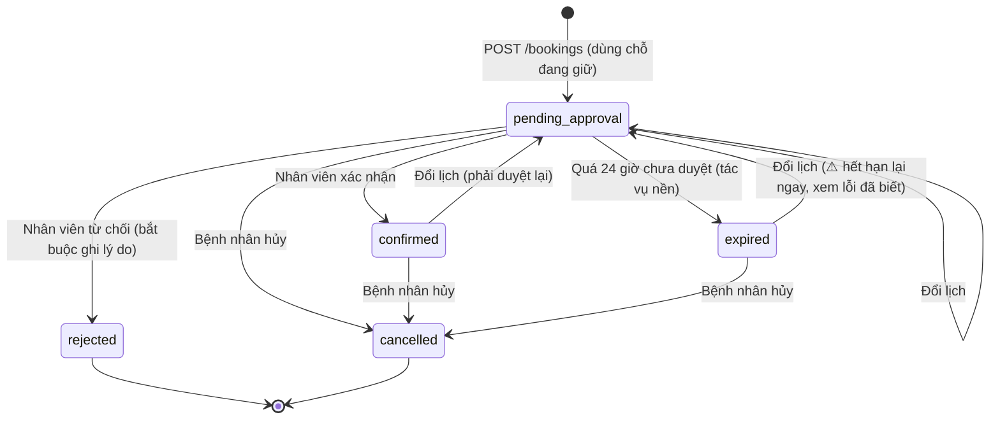
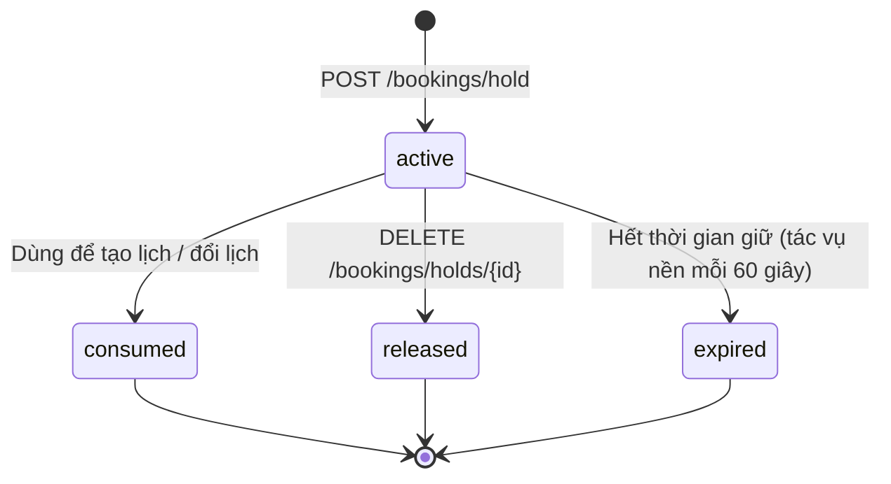

# API Đặt lịch — VCare+ (P-124)

> Đặt lịch, giữ chỗ, hủy, đổi lịch và duyệt lịch. Base URL: `/api/v1`.
> Căn cứ: `src/api/endpoints/booking.py`, `src/schemas/booking.py`, `src/services/booking.py`, `src/medical_assistant/api/routes.py` (develop `42c909e`).
> Xác thực và định dạng lỗi chung: [README.md](README.md).

## Hai cách đặt lịch trong hệ thống

| | **Đặt trực tiếp** (bệnh nhân tự chọn giờ) | **Yêu cầu qua chat** (điều phối viên sắp xếp) |
|---|---|---|
| Endpoint | `POST /bookings/hold` → `POST /bookings` | `POST /booking-requests` |
| Ai dùng | Bệnh nhân đã đăng nhập | Khách hoặc bệnh nhân đã đăng nhập |
| Tạo ra | Một **lịch hẹn** (`Booking`) ở trạng thái `pending_approval` | Một **ca điều phối** trong hàng đợi (chưa phải lịch hẹn) |
| Người thật duyệt | Nhân viên duyệt qua `PATCH /staff/bookings/{id}/status` | Điều phối viên lên phương án, đặt cọc, chốt lịch trên bàn điều phối |

Cả hai cách đều bảo đảm **không lịch nào được xác nhận mà không qua người thật** (ràng buộc HITL).

## Danh sách endpoint

| Method | Path | Quyền | Mục đích |
|---|---|---|---|
| POST | `/bookings/hold` | Bệnh nhân | Giữ chỗ tạm một khung giờ |
| DELETE | `/bookings/holds/{hold_id}` | Đăng nhập | Trả lại chỗ đang giữ |
| POST | `/bookings` | Bệnh nhân | Tạo lịch hẹn (cần `Idempotency-Key`) |
| GET | `/bookings` | Đăng nhập | Danh sách lịch hẹn của mình |
| GET | `/bookings/{booking_id}` | Đăng nhập | Chi tiết một lịch hẹn |
| POST | `/bookings/{booking_id}/cancel` | Đăng nhập | Hủy lịch hẹn / yêu cầu gói khám / ca điều phối |
| POST | `/bookings/{booking_id}/reschedule` | Đăng nhập | Đổi sang khung giờ khác |
| POST | `/booking-requests` | Khách / đăng nhập | Gửi yêu cầu đặt lịch từ chat |
| GET | `/staff/bookings` | Staff | Danh sách lịch hẹn cần xử lý |
| GET | `/staff/bookings/{booking_id}` | Staff | Chi tiết lịch hẹn (có thông tin bệnh nhân, bác sĩ, cơ sở) |
| PATCH | `/staff/bookings/{booking_id}/status` | Staff | Xác nhận hoặc từ chối lịch |

---

## Trạng thái

### Lịch hẹn (`Booking`)

| Trạng thái | Ý nghĩa |
|---|---|
| `pending_approval` | Chờ nhân viên duyệt. Có hạn duyệt `expired_at` = thời điểm tạo + **24 giờ** |
| `confirmed` | Đã xác nhận |
| `rejected` | Nhân viên từ chối (bắt buộc có lý do) |
| `cancelled` | Đã hủy (không xóa dữ liệu) |
| `expired` | Quá 24 giờ chưa được duyệt, tác vụ nền tự chuyển |



Ngoài ra, điều phối viên chốt lịch từ bàn điều phối sẽ tạo lịch hẹn **thẳng ở trạng thái `confirmed`**, vì ca đó đã qua bước người thật kiểm soát (phương án + cọc đã xác minh).

### Giữ chỗ (`BookingHold`)



---

## POST `/bookings/hold`: Giữ chỗ

Giữ tạm một khung giờ để bệnh nhân hoàn tất đặt lịch mà không bị người khác lấy mất.

**Request body** (`BookingHoldCreate`)

| Trường | Kiểu | Bắt buộc | Ràng buộc |
|---|---|---|---|
| `schedule_id` | UUID | Có | Khung giờ của bác sĩ |
| `service_id` | UUID | Có | Dịch vụ khám |
| `specialty_id` | UUID | Có | Chuyên khoa |
| `hold_seconds` | int | Không | 300–600 giây, mặc định **300** (5 phút) |

```bash
curl -X POST http://localhost:8000/api/v1/bookings/hold \
  -H "Authorization: Bearer $ACCESS_TOKEN" -H "Content-Type: application/json" \
  -d '{"schedule_id": "<uuid>", "service_id": "<uuid>", "specialty_id": "<uuid>"}'
```

**Response `201`**: `data` là `BookingHoldResponse`:

```json
{
  "id": "a1b2c3d4-0000-4000-8000-000000000001",
  "user_id": "6f1c2a0e-...",
  "schedule_id": "...", "service_id": "...", "specialty_id": "...",
  "status": "active",
  "expires_at": "2026-10-10T09:35:00Z",
  "released_at": null,
  "created_at": "2026-10-10T09:30:00Z"
}
```

**Lỗi** (`409 CONFLICT` trừ khi ghi khác)

| `error_code` | Khi nào |
|---|---|
| `NOT_FOUND` (404) | Không có dịch vụ / chuyên khoa / khung giờ |
| `SLOT_IN_PAST` | Khung giờ đã qua |
| `HOLD_ALREADY_EXISTS` | Bạn đang giữ chính khung giờ này |
| `SCHEDULE_CONFLICT` | Khung giờ khám riêng với bác sĩ đã có người đặt |
| `CAPACITY_EXCEEDED` | Khung giờ khám nhóm đã hết chỗ |

> Endpoint này trả lỗi 401 theo **định dạng cũ** (`{"legacy_error": {"code": 401}}`) để tương thích với client cũ.

## DELETE `/bookings/holds/{hold_id}`: Trả lại chỗ

**Response `200`**: `data: null`. Chỗ giữ chuyển `released` (hoặc `expired` nếu đã quá hạn). **Lỗi:** `404` không tìm thấy chỗ giữ.

---

## POST `/bookings`: Tạo lịch hẹn

**Header bắt buộc:** `Idempotency-Key: <chuỗi ngẫu nhiên, tối đa 128 ký tự>`. Gửi lại **cùng key + cùng nội dung** sẽ nhận lại đúng lịch đã tạo (HTTP `200`, message "Booking replayed"), không tạo thêm lịch thứ hai.

**Request body** (`BookingCreate`)

| Trường | Kiểu | Bắt buộc | Ràng buộc |
|---|---|---|---|
| `service_id` | UUID | Có | |
| `specialty_id` | UUID | Có | |
| `reason` | string | Có | 1–2000 ký tự, không được toàn khoảng trắng |
| `schedule_id` | UUID | Xem ghi chú | Khung giờ đã chọn |
| `hold_id` | UUID | Xem ghi chú | Chỗ đang giữ; nếu có thì **bắt buộc** có `schedule_id` |
| `doctor_id`, `facility_id`, `starts_at`, `ends_at` | UUID / datetime | Xem ghi chú | Dùng khi đặt theo **thời gian mong muốn** (không có `schedule_id`) |
| `encounter_type` | enum | Không | `in_person` (mặc định) / `telehealth` |
| `patient_note` | string | Không | Tối đa 2000 ký tự |

**Ghi chú:**
- Phải có **hoặc** `schedule_id`, **hoặc** đủ bộ `doctor_id` + `facility_id` + `starts_at` + `ends_at`.
- `starts_at`, `ends_at` **bắt buộc kèm múi giờ** (ví dụ `2026-10-15T08:00:00+07:00`) và `ends_at` phải sau `starts_at`.

```bash
curl -X POST http://localhost:8000/api/v1/bookings \
  -H "Authorization: Bearer $ACCESS_TOKEN" \
  -H "Content-Type: application/json" \
  -H "Idempotency-Key: 7c9e6679-7425-40de-944b-e07fc1f90ae7" \
  -d '{
        "schedule_id": "<uuid>", "hold_id": "<uuid>",
        "service_id": "<uuid>", "specialty_id": "<uuid>",
        "reason": "Đau đầu 3 ngày, hơi chóng mặt"
      }'
```

**Response `201`** ("Booking created"): `data` là `BookingResponse`:

```json
{
  "id": "b7e1...", "user_id": "6f1c...",
  "schedule_id": "...", "hold_id": "...", "service_id": "...", "specialty_id": "...",
  "doctor_id": "...", "facility_id": "...",
  "starts_at": "2026-10-15T01:00:00Z", "ends_at": "2026-10-15T01:30:00Z",
  "booking_mode": "doctor_visit", "encounter_type": "in_person",
  "reason": "Đau đầu 3 ngày, hơi chóng mặt", "patient_note": null,
  "status": "pending_approval",
  "expired_at": "2026-10-11T09:30:00Z",
  "cancellation_reason": null, "staff_note": null, "reviewed_by": null, "reviewed_at": null,
  "created_at": "2026-10-10T09:30:00Z", "updated_at": "2026-10-10T09:30:00Z"
}
```

Sau khi tạo: chỗ giữ chuyển `consumed`, bệnh nhân nhận thông báo `booking_pending_approval`.

**Lỗi**

| HTTP | `error_code` | Khi nào |
|---|---|---|
| 400 | `HTTP_ERROR` | Thiếu header `Idempotency-Key` |
| 400 | `VALIDATION_ERROR` | Thiếu `schedule_id` và thiếu bộ thời gian mong muốn; thời gian không có múi giờ; `hold_id` mà không có `schedule_id` |
| 409 | `IDEMPOTENCY_KEY_REQUIRED` / `IDEMPOTENCY_KEY_REUSED` | Key rỗng / dùng lại key cho nội dung khác |
| 409 | `HOLD_EXPIRED` | Chỗ giữ đã hết hạn hoặc đã trả |
| 409 | `HOLD_SCHEDULE_MISMATCH`, `HOLD_REQUEST_MISMATCH` | Chỗ giữ không khớp khung giờ / dịch vụ / chuyên khoa |
| 409 | `SCHEDULE_CONFLICT`, `CAPACITY_EXCEEDED` | Khung giờ đã có người đặt / hết chỗ |
| 409 | `DOCTOR_UNAVAILABLE`, `DOCTOR_BOOKING_DISABLED` | Bác sĩ không nhận lịch |
| 409 | `FACILITY_UNAVAILABLE`, `FACILITY_NOT_AVAILABLE` | Cơ sở không khả dụng / bác sĩ không làm ở cơ sở này |
| 409 | `SERVICE_NOT_AVAILABLE`, `SPECIALTY_NOT_AVAILABLE` | Dịch vụ / chuyên khoa không khớp khung giờ, bác sĩ |
| 409 | `SLOT_IN_PAST` | Thời điểm khám đã qua |
| 403 | `FORBIDDEN` | Không phải tài khoản bệnh nhân |

---

## GET `/bookings`: Danh sách lịch của tôi

**Query:** `status` (lọc theo trạng thái), `offset` (≥ 0), `limit` (1–100, mặc định 50).
**Response `200`**: `data` là mảng `BookingResponse`.

## GET `/bookings/{booking_id}`: Chi tiết lịch

**Response `200`**: `BookingResponse`. **Lỗi:** `404` (không tồn tại hoặc không phải lịch của bạn).

---

## POST `/bookings/{booking_id}/cancel`: Hủy

```json
{ "reason": "Bận việc đột xuất" }
```

`reason`: không bắt buộc, tối đa 500 ký tự.

Endpoint này **đa năng**: `{booking_id}` có thể là mã của 1 trong 3 loại đối tượng, và backend tự nhận diện theo thứ tự sau:

| Thứ tự | Đối tượng | Kết quả khi hủy |
|---|---|---|
| 1 | **Lịch hẹn** (`Booking`) | Lịch → `cancelled`; lịch tư vấn liên quan (nếu có) cũng bị hủy |
| 2 | **Yêu cầu gói khám** (`PackageRequest`) | Yêu cầu → `cancelled` |
| 3 | **Ca điều phối** (`CoordinationCase`) | Ca → `cancelled`; cọc đã xác minh → `refund_pending`, cọc chưa nộp → `voided`; lịch hẹn gắn với ca → `cancelled` |

**Response `200`**: `BookingResponse` của đối tượng đã hủy.

**Lỗi**

| HTTP | `error_code` | Khi nào |
|---|---|---|
| 404 | `NOT_FOUND` | Không tìm thấy, hoặc không thuộc về bạn |
| 409 | `BOOKING_ALREADY_CANCELLED` | Đã hủy trước đó |
| 409 | `BOOKING_NOT_CANCELLABLE` | Lịch bị từ chối; gói khám / ca đã hoàn tất |

---

## POST `/bookings/{booking_id}/reschedule`: Đổi lịch

Giữ chỗ khung giờ mới trước (`POST /bookings/hold`), rồi gọi:

```json
{ "schedule_id": "<uuid khung giờ mới>", "hold_id": "<uuid chỗ giữ mới>" }
```

**Response `200`**: `BookingResponse`. Lịch quay về **`pending_approval`** (kể cả khi trước đó đã `confirmed`), chỗ giữ mới chuyển `consumed`, nhắc lịch cũ bị hủy.

> ⚠️ **Lỗi đã biết:** hạn duyệt `expired_at` **không được tính lại** khi đổi lịch (`reschedule()` trong `src/services/booking.py`). Đổi lịch cho lịch đã `expired` sẽ đưa lịch về `pending_approval` với hạn duyệt đã qua, nên tác vụ nền chuyển nó về `expired` lại trong vòng 60 giây. Cần đặt lại `expired_at` = thời điểm đổi + 24 giờ.

**Lỗi**

| `error_code` | Khi nào |
|---|---|
| `COORDINATED_BOOKING` | Lịch do điều phối viên sắp xếp: phải liên hệ điều phối viên để đổi |
| `BOOKING_NOT_RESCHEDULABLE` | Lịch đã hủy / bị từ chối, hoặc lịch theo "thời gian mong muốn" (chưa hỗ trợ) |
| `SAME_SCHEDULE` | Chọn trùng khung giờ cũ |
| `HOLD_EXPIRED`, `HOLD_SCHEDULE_MISMATCH`, `HOLD_REQUEST_MISMATCH` | Chỗ giữ mới không hợp lệ |
| `SCHEDULE_CONFLICT`, `CAPACITY_EXCEEDED` | Khung giờ mới đã có người đặt / hết chỗ |

> Code cho phép đổi lịch ở trạng thái `expired` (chỉ chặn `cancelled`, `rejected`), nhưng do lỗi ở trên, lịch sẽ bị hết hạn lại gần như ngay lập tức.

---

## POST `/booking-requests`: Yêu cầu đặt lịch từ chat

Gửi sau khi trợ lý gợi ý chuyên khoa. **Tạo ca điều phối**, không tạo lịch hẹn.

**Request body** (`BookingIntakeRequest`)

| Trường | Kiểu | Bắt buộc | Ràng buộc |
|---|---|---|---|
| `session_id` | string | Có | 8–200 ký tự, phiên chat đang tư vấn |
| `patient_name` | string | Có | 2–120 ký tự |
| `patient_phone` | string | Có | Số di động Việt Nam hợp lệ |
| `date_of_birth` | date | Có | Không ở tương lai |
| `consent_to_contact` | bool | **Có, phải là `true`** | Đồng ý cho điều phối viên liên hệ |
| `preferred_date` | date | Có (thực tế) | Từ hôm nay đến **90 ngày** tới |
| `preferred_period` | enum | Không | `morning` / `afternoon` / `evening` / `any` (mặc định) |
| `guardian_name`, `guardian_phone` | string | Có nếu dưới 18 tuổi | |
| `patient_email`, `gender`, `specialty_name`, `specialty_code`, `preferred_doctor_id`, `selected_slot_id`, `facility_preference`, `contact_time_preference`, `patient_notes`, `patient_profile_id` | | Không | |

**Response `201`**: mã yêu cầu và thông báo "chưa phải lịch đã xác nhận, điều phối viên sẽ liên hệ".

**Lỗi**

| HTTP | Khi nào |
|---|---|
| 422 | `consent_to_contact = false`: "Cần đồng ý để điều phối viên liên hệ." |
| 422 | Họ tên dưới 2 ký tự, số điện thoại / ngày sinh không hợp lệ, ngày khám trong quá khứ hoặc quá 90 ngày, thiếu thông tin người giám hộ |
| 409 | Phiên có dấu hiệu cấp cứu: "Ca có dấu hiệu cấp cứu không được chuyển sang đặt lịch thường." |

Luồng xử lý tiếp theo của ca: xem `docs/requirements/use-cases.md` (UC-03).

---

## API cho nhân viên

### GET `/staff/bookings`

**Query:** `status`, `date` (lọc theo ngày khám, `YYYY-MM-DD`), `offset`, `limit` (1–200, mặc định 100).
**Response `200`**: mảng `StaffBookingResponse` = `BookingResponse` + thông tin hiển thị:

| Nhóm | Trường |
|---|---|
| Bệnh nhân | `patient_name`, `patient_email`, `patient_phone`, `patient_date_of_birth`, `patient_gender`, `patient_citizen_id`, `patient_health_insurance_code` |
| Bác sĩ | `doctor_name`, `doctor_title`, `doctor_avatar` |
| Khác | `specialty_name`, `service_name`, `facility_name`, `facility_address`, `room` |

### GET `/staff/bookings/{booking_id}`

**Response `200`**: `StaffBookingResponse`. **Lỗi:** `404`.

### PATCH `/staff/bookings/{booking_id}/status`: Xác nhận / từ chối

```json
{ "status": "rejected", "note": "Bác sĩ nghỉ đột xuất, vui lòng chọn khung giờ khác" }
```

| Trường | Ràng buộc |
|---|---|
| `status` | `confirmed` hoặc `rejected` |
| `note` | Tối đa 2000 ký tự; **bắt buộc khi từ chối** |

**Response `200`**: `StaffBookingResponse`. Bệnh nhân nhận thông báo `booking_confirmed` / `booking_rejected`; ca điều phối liên quan được cập nhật.

**Lỗi**

| `error_code` | Khi nào |
|---|---|
| `BOOKING_ALREADY_REVIEWED` | Lịch không còn ở `pending_approval` |
| `REJECTION_NOTE_REQUIRED` | Từ chối mà không ghi lý do |
| `SCHEDULE_UNAVAILABLE` | Khung giờ không còn khả dụng khi xác nhận |
| `SCHEDULE_CONFLICT`, `CAPACITY_EXCEEDED` | Khung giờ đã có người khác / hết chỗ |
| `FORBIDDEN` (403) | Không phải staff |
