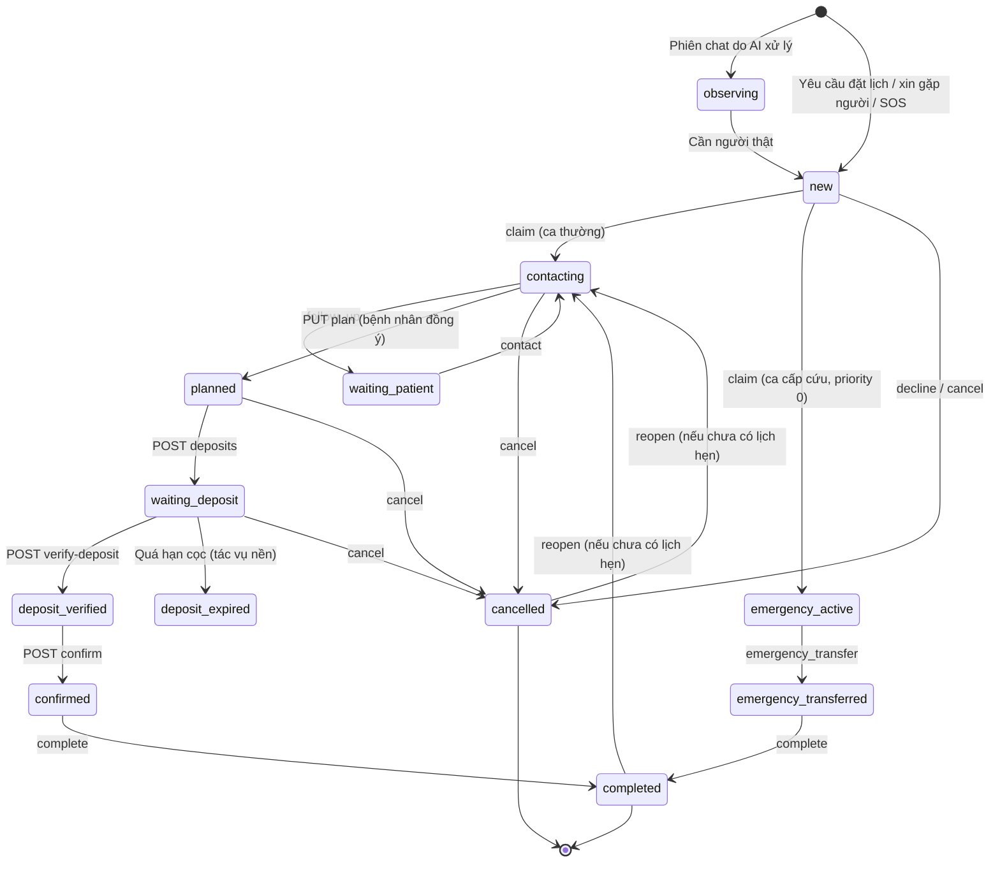

# API Nhân viên & Bàn điều phối — VCare+ (P-124)

> Các endpoint `/staff/*` dành cho điều phối viên, lễ tân và quản trị. Base URL: `/api/v1`.
> Căn cứ: `src/api/endpoints/workbench.py`, `src/services/workbench.py`, `src/schemas/workbench.py` và các module `coordination`, `chat_takeover`, `staff_dashboard`, `staff_patient`, `package`, `doctor`, `schedule`, `service`, `specialty`, `facility` (develop `42c909e`).
> Xác thực và định dạng lỗi chung: [README.md](README.md). Duyệt lịch đặt trực tiếp (`/staff/bookings/*`): [booking.md](booking.md).

## Mức quyền trong tài liệu này

| Mức | Điều kiện |
|---|---|
| **Staff** | `role = "staff"` |
| **Thành viên điều phối** | Staff **và** có bản ghi `CoordinatorMember` đang bật (`enabled`). Có thể bị giới hạn theo cơ sở (`facility_ids`) |
| **Quản trị** | Thành viên điều phối có `is_admin = true` **và** không giới hạn cơ sở |

## Tổng quan nhóm endpoint

| Nhóm | Tiền tố | Số endpoint | Quyền | Mục đích |
|---|---|---|---|---|
| **Bàn điều phối** | `/staff/workbench` | 19 | Thành viên điều phối (một số cần Quản trị) | Xử lý ca: nhận, liên hệ, lên phương án, đặt cọc, chốt lịch |
| Tiếp quản chat | `/staff/chat-takeover` | 9 | Staff | Vé WebSocket, danh sách ca chat, nhắn tin trực tiếp |
| Duyệt lịch đặt trực tiếp | `/staff/bookings` | 3 | Staff | Xem [booking.md](booking.md) |
| Lịch tư vấn & quy tắc ca | `/staff/coordination` | 7 | Quản trị | Khung trực tuần, phát hành lịch tư vấn, phân công yêu cầu |
| Danh mục | `/staff/doctors`, `/services`, `/specialties`, `/facilities` | 12 | Staff | Thêm / sửa danh mục |
| Lịch bác sĩ | `/staff/schedules`, `/staff/schedule-activity` | 6 | Staff | Tạo, sửa, hủy, nhập lịch |
| Gói khám | `/staff/packages/requests` | 2 | Quản trị | Xử lý yêu cầu gói khám |
| Bệnh nhân & tổng quan | `/staff/patients`, `/staff/dashboard/summary` | 3 | Staff | Tra cứu bệnh nhân, số liệu tổng quan |

---

## 1. Bàn điều phối (`/staff/workbench`)

Đây là màn hình làm việc chính của điều phối viên (trang `/staff/coordination`, `/staff/queue`, `/staff/emergency`, `/staff/chat` trên frontend).

### 1.1. Ca điều phối và vòng đời

Một **ca** được tạo khi: bệnh nhân gửi yêu cầu đặt lịch từ chat, xin gặp người thật, bấm SOS, hoặc có cảnh báo cấp cứu. Ca có `priority` từ 0 (cấp cứu, cao nhất) đến 3.

| Trạng thái | Ý nghĩa |
|---|---|
| `observing` | Phiên chat đang do AI xử lý, chưa cần người |
| `new` | Ca mới vào hàng đợi, chưa ai nhận |
| `contacting` | Đã có người nhận, đang liên hệ bệnh nhân |
| `waiting_patient` | Chờ bệnh nhân phản hồi (có hẹn nhắc việc) |
| `emergency_active` | Ca cấp cứu đang được xử lý |
| `emergency_transferred` | Đã chuyển giao cấp cứu |
| `planned` | Đã thống nhất phương án khám với bệnh nhân |
| `waiting_deposit` | Đã yêu cầu đặt cọc, chờ bệnh nhân chuyển |
| `deposit_verified` | Nhân viên đã xác minh nhận cọc |
| `deposit_expired` | Cọc quá hạn chưa nộp |
| `confirmed` | Đã chốt lịch (tạo lịch hẹn `confirmed`) |
| `completed` | Hoàn tất |
| `cancelled` | Đã hủy |



### 1.2. Khóa phiên bản `version` (chống ghi đè)

Mọi thao tác thay đổi ca (`actions`, `plan`, `deposits`, `verify-deposit`, `confirm`) phải gửi kèm `version` hiện tại của ca (lấy từ `GET /cases/{id}`). Nếu người khác đã sửa ca trong lúc đó, `version` không khớp → **409**, client cần tải lại ca. Cơ chế này ngăn 2 điều phối viên ghi đè lên nhau.

### 1.3. Danh sách endpoint

| Method | Path | Quyền | Mục đích |
|---|---|---|---|
| GET | `/staff/workbench/me` | Thành viên | Thông tin của tôi: vai trò, quản trị hay không, phạm vi cơ sở, đang trực |
| POST | `/staff/workbench/duty/start` | Thành viên | Bắt đầu ca trực |
| POST | `/staff/workbench/duty/end` | Thành viên | Kết thúc ca trực |
| POST | `/staff/workbench/duty/handover` | Thành viên | Bàn giao **toàn bộ** ca chưa đóng cho đồng nghiệp |
| GET | `/staff/workbench/dashboard` | Thành viên | Số liệu hàng đợi |
| GET | `/staff/workbench/catalog` | Thành viên | Danh mục (chuyên khoa, dịch vụ, khung giờ) để lên phương án |
| GET | `/staff/workbench/cases` | Thành viên | Hàng đợi ca |
| GET | `/staff/workbench/cases/{case_id}` | Thành viên | Chi tiết ca: bệnh nhân, bối cảnh AI, lịch sử sự kiện, tin nhắn |
| POST | `/staff/workbench/cases/{case_id}/actions` | Thành viên | Thao tác trên ca (xem 1.4) |
| POST | `/staff/workbench/cases/bulk-actions` | Thành viên | Nhận / từ chối nhiều ca một lúc |
| PUT | `/staff/workbench/cases/{case_id}/plan` | Thành viên | Lưu phương án khám |
| POST | `/staff/workbench/cases/{case_id}/deposits` | Thành viên | Yêu cầu đặt cọc |
| POST | `/staff/workbench/cases/{case_id}/verify-deposit` | Thành viên | Xác minh đã nhận cọc |
| POST | `/staff/workbench/cases/{case_id}/confirm` | Thành viên | **Chốt lịch** |
| POST | `/staff/workbench/cases/{case_id}/messages` | Thành viên | Nhắn tin cho bệnh nhân |
| GET | `/staff/workbench/members` | Thành viên | Danh sách thành viên điều phối (email chỉ hiện cho quản trị) |
| PUT | `/staff/workbench/members` | **Quản trị** | Thêm / sửa quyền thành viên |
| GET | `/staff/workbench/policy` | Thành viên | Xem chính sách điều phối |
| PUT | `/staff/workbench/policy` | **Quản trị** | Cấu hình chính sách điều phối |

Điều phối viên bị giới hạn cơ sở chỉ thấy và xử lý ca thuộc cơ sở của mình (hoặc ca chưa gắn cơ sở).

### 1.4. GET `/staff/workbench/cases`: Hàng đợi

| Query | Kiểu | Ghi chú |
|---|---|---|
| `status` | string | Lọc theo trạng thái |
| `priority` | int | 0–3 (0 = cấp cứu) |
| `mine` | bool | Chỉ ca tôi phụ trách |
| `conversations` | bool | Chỉ ca có hội thoại chat |
| `q` | string | Tìm kiếm, tối đa 200 ký tự |
| `offset`, `limit` | int | `limit` 1–100, mặc định 50 |

### 1.5. POST `/staff/workbench/cases/{case_id}/actions`: Thao tác trên ca

**Body** (`CaseAction`)

| Trường | Kiểu | Ràng buộc |
|---|---|---|
| `version` | int | **Bắt buộc**, ≥ 1 |
| `action` | enum | Xem bảng dưới |
| `note` | string | Tối đa 4000 ký tự; **bắt buộc** với một số thao tác |
| `assigned_to` | UUID | Người nhận, dùng cho `handover` |
| `follow_up_at` | datetime | Thời điểm nhắc việc, dùng cho `follow_up` |
| `reference` | string | Mã giao dịch hoàn tiền, dùng cho `refund_confirm` |

```bash
curl -X POST http://localhost:8000/api/v1/staff/workbench/cases/<case_id>/actions \
  -H "Authorization: Bearer $STAFF_TOKEN" -H "Content-Type: application/json" \
  -d '{"version": 3, "action": "claim"}'
```

| `action` | Cần `note` | Tác dụng |
|---|---|---|
| `claim` | Không | Nhận ca. Ca chuyển `contacting`, hoặc `emergency_active` nếu là ca cấp cứu; bật trạng thái đang trực |
| `decline` | Không | Từ chối ca: trả chỗ giữ, ca → `cancelled` |
| `handover` | **Có** | Bàn giao ca cho `assigned_to` (phải là đồng nghiệp **khác**, đang trực, có quyền với ca) |
| `takeover` | Không | Người thật tiếp quản chat; AI ngừng trả lời. Ca phải có hội thoại |
| `resume` | **Có** | Trả quyền chat cho AI; `note` thành **tóm tắt bàn giao** cho AI |
| `contact` | **Có** | Ghi nhận đã liên hệ; ca → `contacting` |
| `follow_up` | Không | Hẹn nhắc việc ở `follow_up_at` (phải trong tương lai); ca → `waiting_patient` |
| `emergency_ack` | **Có** | Xác nhận đang xử lý cấp cứu → `emergency_active` |
| `emergency_transfer` | **Có** | Đã chuyển giao cấp cứu → `emergency_transferred` |
| `complete` | **Có** | Hoàn tất; chỉ khi ca đã `confirmed` hoặc `emergency_transferred` |
| `cancel` | **Có** | Hủy ca: trả chỗ giữ; cọc đã xác minh → `refund_pending`, cọc chưa nộp → `voided`; hủy lịch hẹn gắn với ca; trả chat về AI |
| `reopen` | **Có** | Mở lại ca đã hủy / hoàn tất → `contacting`, **chỉ khi ca chưa có lịch hẹn** |
| `refund_request` | **Có** | Yêu cầu hoàn cọc → `refund_pending` |
| `refund_confirm` | **Có** | Xác nhận đã hoàn tiền, cần `reference` (mã giao dịch thật) → `refunded` |

**Lỗi thường gặp:**
- `409` "Ca đã đóng." (thao tác trên ca `completed` / `cancelled`, trừ `reopen` và hoàn cọc)
- `409` "Ca đã có người phụ trách."
- `409` "Ca này không có hội thoại."
- `409` "Chỉ hoàn tất ca đã chốt khám hoặc bàn giao cấp cứu."
- `409` "Ca có lịch đã chốt cần tạo phương án đổi lịch, không mở lại trực tiếp."
- `409` "Không có khoản cọc cần hoàn."
- `422` "Cần ghi lý do hoặc kết quả xử lý." (thiếu `note`)
- `422` "Người nhận không có quyền hoặc không thuộc phạm vi ca."
- `422` "Chọn thời điểm nhắc việc trong tương lai."
- `403` "Quyền điều phối đã bị thu hồi."

### 1.6. POST `/staff/workbench/cases/bulk-actions`

```json
{ "case_ids": ["<uuid>", "<uuid>"], "action": "claim", "note": "" }
```

`case_ids`: 1–100 ca; `action`: chỉ `claim` hoặc `decline`.

### 1.7. PUT `/staff/workbench/cases/{case_id}/plan`: Lên phương án

```json
{
  "version": 4,
  "specialty_id": "<uuid>", "service_id": "<uuid>", "schedule_id": "<uuid>",
  "reason": "Đau đầu 3 ngày, cần khám Thần kinh",
  "patient_agreed": true
}
```

| Trường | Ràng buộc |
|---|---|
| `reason` | 2–2000 ký tự |
| `patient_agreed` | **Phải là `true`**: chỉ lưu phương án khi bệnh nhân đã đồng ý |

Hệ thống kiểm tra khung giờ còn hợp lệ, khớp chuyên khoa / dịch vụ và thuộc phạm vi cơ sở của người thao tác; sau đó giữ chỗ khung giờ trong `hold_minutes` phút (theo chính sách). Ca → `planned`.

### 1.8. POST `.../deposits` và `.../verify-deposit`: Đặt cọc

**Yêu cầu cọc:**

```json
{ "version": 5, "amount": 200000 }
```

`amount`: số nguyên VNĐ, > 0. Điều kiện: ca ở `planned`, bệnh nhân đã đồng ý phương án, quản trị **đã cấu hình chính sách cọc**. Bệnh nhân nhận thông báo `deposit_requested` kèm hướng dẫn thanh toán. Ca → `waiting_deposit`.

**Xác minh đã nhận cọc:**

```json
{ "version": 6, "reference": "FT2610100012345", "evidence": "Đã đối soát sao kê ngân hàng 10/10, khớp số tiền" }
```

`reference`, `evidence`: 2–200 / 2–2000 ký tự, không được để trống. Ca → `deposit_verified`.

**Lỗi:** `409` "Quản trị viên cần cấu hình điều khoản cọc trước." · `409` "Cần thống nhất phương án khám trước khi yêu cầu cọc."

### 1.9. POST `.../confirm`: Chốt lịch

```json
{ "version": 7 }
```

Điều kiện: người thao tác là người phụ trách ca, đã có **cọc được xác minh**, khung giờ vẫn hợp lệ. Kết quả: tạo **lịch hẹn ở trạng thái `confirmed`**, ca → `confirmed`, bệnh nhân nhận thông báo `booking_confirmed`.

**Lỗi:** `409` "Cần xác minh cọc trước khi chốt lịch."

### 1.10. POST `.../messages`: Nhắn tin cho bệnh nhân

```json
{ "client_id": "<uuid tự sinh>", "body": "Chào anh An, em là điều phối viên ..." }
```

`body`: 1–5000 ký tự, không để trống. `client_id` dùng để chống gửi trùng.

### 1.11. Ca trực

- `POST /duty/start`, `POST /duty/end`: không cần body.
- `POST /duty/handover`:

```json
{ "assigned_to": "<uuid đồng nghiệp>", "note": "Bàn giao 3 ca, ca của chị B cần gọi lại lúc 15h" }
```

`note` 2–4000 ký tự. Không được bàn giao cho chính mình. Toàn bộ ca chưa đóng của bạn chuyển cho người nhận.

### 1.12. Quản trị: thành viên và chính sách

**PUT `/staff/workbench/members`** (Quản trị):

```json
{
  "user_id": "<uuid tài khoản staff>",
  "enabled": true,
  "is_admin": false,
  "facility_ids": ["<uuid cơ sở>"],
  "clinical_qualification": "Điều dưỡng điều phối"
}
```

`facility_ids`: tối đa 100; để rỗng = không giới hạn cơ sở. `clinical_qualification`: 2–200 ký tự. Quản trị **không thể tự tắt** hoặc **tự bỏ quyền quản trị** của chính mình.

**PUT `/staff/workbench/policy`** (Quản trị):

```json
{
  "hold_minutes": 30,
  "response_minutes": 60,
  "emergency_response_minutes": 5,
  "payment_instructions": "Chuyển khoản tới STK ... nội dung: mã ca",
  "refund_policy": "Hoàn 100% nếu hủy trước 24 giờ ..."
}
```

| Trường | Ràng buộc |
|---|---|
| `hold_minutes` | 5–1440 phút giữ chỗ khi lên phương án |
| `response_minutes` | 1–10080 phút: thời hạn phản hồi ca thường |
| `emergency_response_minutes` | 1–60 phút: thời hạn phản hồi ca cấp cứu |
| `payment_instructions`, `refund_policy` | 10–4000 ký tự, nội dung thật |

**Lỗi:** `403` "Chỉ quản trị viên điều phối được cấp quyền." / "…được cấu hình chính sách."

---

## 2. Tiếp quản chat (`/staff/chat-takeover`)

| Method | Path | Quyền | Mục đích |
|---|---|---|---|
| GET | `/ticket` | Đăng nhập | Lấy vé để mở WebSocket (dùng cho cả bệnh nhân và nhân viên) |
| GET | `/cases` | Staff | Danh sách ca chat cần tiếp quản |
| GET | `/cases/{case_id}` | Staff | Chi tiết ca và tin nhắn |
| POST | `/cases/{case_id}/claim` | Staff | Nhận ca chat |
| POST | `/cases/{case_id}/messages` | Staff | Gửi tin nhắn: `{"content": "1–4000 ký tự", "client_message_id": "…"}` |
| POST | `/cases/{case_id}/release` | Staff | Trả ca |
| POST | `/cases/{case_id}/resolve` | Staff | Đóng ca |
| WS | `/ws/staff?token=<vé>` | Staff | Nhận cập nhật realtime cho nhân viên |
| WS | `/ws/{session_id}?token=<vé>` | Đăng nhập ⚠️ | Bệnh nhân nhận tin nhắn của nhân viên |

> Hệ thống có **hai cơ chế tiếp quản**: thao tác `takeover`/`resume` trên bàn điều phối (mục 1.5) và nhóm `/staff/chat-takeover` này. Frontend dùng cả hai: bàn điều phối để điều khiển, `chat-takeover` để lấy vé và kết nối WebSocket.
>
> ⚠️ WebSocket phía bệnh nhân chỉ kiểm tra **đã đăng nhập**, chưa kiểm tra `session_id` có thuộc người kết nối hay không. Xem [endpoints.md](endpoints.md).

---

## 3. Lịch tư vấn & quy tắc ca (`/staff/coordination`): Quản trị

| Method | Path | Mục đích |
|---|---|---|
| GET | `/rules` | Danh sách khung trực tuần |
| POST | `/rules` | Tạo một khung trực |
| POST | `/rules/standard-week` | Tạo nhanh tuần làm việc chuẩn cho một bác sĩ |
| POST | `/publish` | Phát hành lịch tư vấn trong khoảng ngày |
| GET | `/requests` | Danh sách yêu cầu tư vấn của bệnh nhân |
| POST | `/requests/{request_id}/assign` | Phân công yêu cầu vào một khung giờ |
| POST | `/requests/{request_id}/reject` | Từ chối yêu cầu |

**POST `/rules`** (`ShiftInput`):

| Trường | Ràng buộc |
|---|---|
| `doctor_id`, `facility_id` | UUID |
| `weekday` | 0–6 (0 = thứ Hai) |
| `period` | `morning` / `afternoon` |
| `start_time` | Giờ bắt đầu, ví dụ `08:00` |
| `slot_minutes` | 5–240, mặc định 30 |
| `slot_count` | 1–20, mặc định 5 |
| `effective_from`, `effective_until` | Ngày áp dụng (đến ngày có thể bỏ trống) |

**POST `/rules/standard-week`**: `{"doctor_id", "facility_id", "effective_from"}`.
**POST `/publish`**: `{"from_date": "2026-10-13", "through_date": "2026-10-19"}`.

---

## 4. Danh mục và lịch bác sĩ (Staff)

| Method | Path | Mục đích |
|---|---|---|
| GET / POST | `/staff/doctors` | Danh sách / thêm bác sĩ |
| GET / PATCH | `/staff/doctors/{doctor_id}` | Xem / sửa bác sĩ |
| PATCH | `/staff/doctors/{doctor_id}/toggle-booking` | Bật / tắt nhận lịch của bác sĩ |
| GET / POST | `/staff/services` | Danh sách / thêm dịch vụ |
| PATCH | `/staff/services/{service_id}` | Sửa dịch vụ |
| POST | `/staff/specialties` | Thêm chuyên khoa |
| PATCH | `/staff/specialties/{specialty_id}` | Sửa chuyên khoa |
| POST | `/staff/facilities` | Thêm cơ sở |
| PATCH | `/staff/facilities/{facility_id}` | Sửa cơ sở |
| GET / POST | `/staff/schedules` | Danh sách / tạo lịch làm việc |
| PUT | `/staff/schedules/{schedule_id}` | Sửa lịch |
| DELETE | `/staff/schedules/{schedule_id}/cancel` | Hủy lịch |
| POST | `/staff/schedules/import` | Nhập lịch hàng loạt (báo kết quả từng dòng) |
| GET | `/staff/schedule-activity` | Nhật ký thay đổi lịch |

Quy tắc chính:
- Mọi thay đổi danh mục đều được ghi **nhật ký kiểm toán**.
- Lịch trùng giờ của cùng bác sĩ bị chặn.
- Mã cơ sở, mã danh mục, số giấy phép hành nghề phải là duy nhất (`FACILITY_CODE_EXISTS`, `CODE_EXISTS`, `LICENSE_EXISTS`).
- Frontend chỉ cho **quản trị** mở trang quản lý bác sĩ và dịch vụ (`StaffAdminGate`). Backend cho mọi staff gọi các API này.

---

## 5. Gói khám (`/staff/packages/requests`): Quản trị

| Method | Path | Mục đích |
|---|---|---|
| GET | `/staff/packages/requests` | Danh sách yêu cầu gói khám |
| PATCH | `/staff/packages/requests/{request_id}` | Cập nhật trạng thái |

```json
{ "status": "contacted", "staff_note": "Đã gọi xác nhận lịch sáng thứ 5" }
```

`status`: `pending` / `contacted` / `confirmed` / `cancelled` / `completed`. Hiện **chưa có trang frontend** nào dùng 2 endpoint này.

---

## 6. Bệnh nhân và tổng quan (Staff)

| Method | Path | Mục đích |
|---|---|---|
| GET | `/staff/patients` | Tìm bệnh nhân. Trả `{items, total, offset, limit}`, mỗi phần tử có `id`, `full_name`, `email`, `phone`, `status`, `gender`, `created_at` |
| GET | `/staff/patients/{patient_id}` | Chi tiết bệnh nhân. CCCD và số BHYT được **che bớt** (`citizen_id_masked`, `health_insurance_code_masked`) |
| GET | `/staff/dashboard/summary` | Số liệu tổng quan cho trang `/staff/overview` |

---

## Lưu ý về phân quyền

| Điểm | Chi tiết |
|---|---|
| Quản trị vs staff ở backend | Chỉ nhóm `/staff/coordination`, `/staff/packages`, `PUT members`, `PUT policy` kiểm tra quyền **quản trị**. Các API danh mục chỉ cần **staff**, việc giới hạn cho quản trị chỉ có ở frontend |
| Phạm vi cơ sở | Chỉ bàn điều phối áp dụng giới hạn `facility_ids`. Danh mục, lịch bác sĩ và duyệt lịch đặt trực tiếp **không** lọc theo cơ sở |
