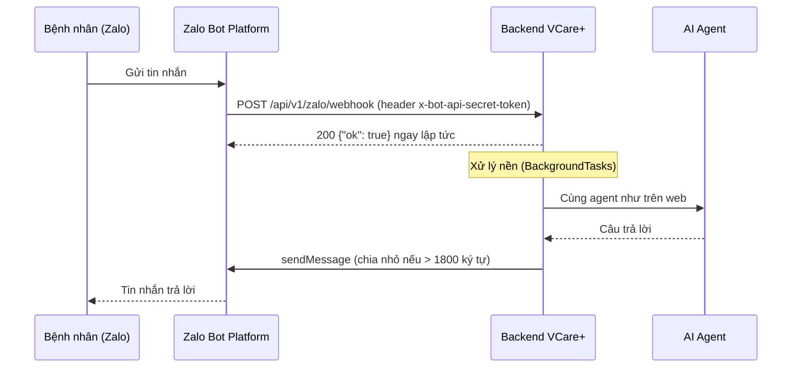

# API & Tích hợp Zalo Bot — VCare+ (P-124)

> Kết nối trợ lý y tế với **Zalo Bot Platform** để bệnh nhân tư vấn và tra lịch hẹn ngay trong Zalo. Base URL: `/api/v1`.
> Căn cứ: `src/api/endpoints/zalo.py`, `src/zalo/` (`client.py`, `service.py`, `schemas.py`), `src/config.py` (develop `42c909e`).

## Cách hoạt động



- Backend **trả `200` ngay** rồi mới xử lý tin nhắn ở chế độ nền, vì Zalo yêu cầu webhook phản hồi nhanh (dưới 5 giây).
- Tin nhắn được xử lý bởi **cùng AI agent** như trên web: kiểm tra cấp cứu, guardrail, hỏi làm rõ, gợi ý chuyên khoa.
- Backend gọi API Zalo tại `https://bot-api.zaloplatforms.com/bot<TOKEN>/<method>`.

## Danh sách endpoint

| Method | Path | Quyền | Mục đích |
|---|---|---|---|
| POST | `/zalo/webhook` | Zalo (header bí mật) | Nhận sự kiện tin nhắn từ Zalo |
| GET | `/zalo/status` | Công khai | Kiểm tra cấu hình bot |
| GET / POST | `/zalo/setup-webhook` | Công khai ⚠️ | Đăng ký URL webhook với Zalo |

---

## Cấu hình biến môi trường

Khai báo trong file `.env` của backend (xem `.env.example`):

| Biến | Bắt buộc | Mặc định | Ý nghĩa |
|---|---|---|---|
| `ZALO_BOT_TOKEN` | **Có** | rỗng | Token của bot, lấy tại Zalo Bot Creator (`https://bot.zapps.me`). Không có token thì bot không gửi được tin |
| `ZALO_BOT_SECRET_TOKEN` | Nên có | rỗng | Chuỗi bí mật **tự đặt**. Zalo gửi kèm trong header `x-bot-api-secret-token` của mỗi webhook. Nếu cấu hình, mọi webhook sai chuỗi này bị từ chối (403) |
| `ZALO_WEBHOOK_URL` | Có (chế độ webhook) | rỗng | URL **HTTPS công khai** để Zalo gọi về, ví dụ `https://api.ten-mien.vn/api/v1/zalo/webhook` |
| `ZALO_BOT_MODE` | Không | `disabled` | `disabled` / `polling` / `webhook`. Hiện **chỉ để hiển thị** trong `/zalo/status` (xem mục Hạn chế) |

```env
ZALO_BOT_TOKEN=<token-tu-zalo-bot-creator>
ZALO_BOT_SECRET_TOKEN=<chuoi-ngau-nhien-dai>
ZALO_BOT_MODE=webhook
ZALO_WEBHOOK_URL=https://api.ten-mien.vn/api/v1/zalo/webhook
```

**Không bao giờ commit token thật lên GitHub** (repo đang để public). Trên server, đưa vào GitHub Secrets hoặc file `.env` của máy chủ.

### Các bước bật bot

1. Tạo bot tại Zalo Bot Creator và lấy token.
2. Điền 4 biến trên vào `.env` của backend rồi khởi động lại.
3. Gọi `POST /api/v1/zalo/setup-webhook` một lần để đăng ký URL webhook với Zalo.
4. Gọi `GET /api/v1/zalo/status` để kiểm tra: `is_configured: true`, `bot_info` chứa thông tin bot.
5. Nhắn thử `/start` cho bot trên Zalo.

Môi trường phát triển trên máy cá nhân cần một URL HTTPS công khai trỏ về máy (ví dụ dùng ngrok) để Zalo gọi được webhook.

---

## POST `/zalo/webhook`

**Header:** `x-bot-api-secret-token: <ZALO_BOT_SECRET_TOKEN>` (bắt buộc khi đã cấu hình secret).

**Body** (`ZaloWebhookPayload`): backend chấp nhận **cả 2 dạng** Zalo gửi.

Dạng lồng trong `result`:

```json
{
  "ok": true,
  "result": {
    "event_name": "message.text.received",
    "message": {
      "from": { "id": "8f2c...", "display_name": "Nguyễn Văn An", "is_bot": false },
      "chat": { "id": "8f2c...", "chat_type": "PRIVATE" },
      "message_id": "msg-001",
      "date": 1760086800,
      "text": "Tôi bị đau đầu 3 ngày nay"
    }
  }
}
```

Dạng phẳng: `{"event_name": "...", "message": { ... }}`.

Trường `message` còn có thể chứa `photo`, `caption`, `sticker`, `voice_url`. Hiện bot **chỉ xử lý tin nhắn văn bản**; ảnh, sticker, ghi âm không có `text` sẽ bị bỏ qua, không trả lời.

**Response `200`:** `{"ok": true, "message": "Event queued successfully"}`

**Lỗi:** `403` "Invalid secret token" (sai header bí mật) · `400 VALIDATION_ERROR` (body sai cấu trúc).

---

## Lệnh và cách bot phản hồi

| Tin nhắn | Bot làm gì |
|---|---|
| `/start` | Gửi lời chào |
| `/help` | Hướng dẫn các lệnh |
| `/link <số điện thoại>` | Liên kết tài khoản Zalo với tài khoản web có số điện thoại đó (⚠️ xem mục Bảo mật) |
| `/my_bookings` hoặc `xem lịch khám`, `lịch khám`, `lich kham`, `xem lich` | Liệt kê lịch hẹn (tối đa 5 lịch gần nhất) và các ca điều phối của người dùng đã liên kết |
| Mọi tin nhắn khác | Chuyển cho AI agent tư vấn |

Bot nhận diện người dùng Zalo qua bảng liên kết (`ZaloUserMapping`): mỗi tài khoản Zalo gắn với một người dùng web và/hoặc một số điện thoại.

---

## Giới hạn độ dài tin nhắn

Zalo giới hạn **2000 ký tự** mỗi tin. Backend chủ động chia câu trả lời dài thành nhiều tin, **mỗi tin tối đa 1800 ký tự** để chừa khoảng an toàn (`split_message_chunks` trong `src/zalo/client.py`).

Thứ tự ưu tiên điểm cắt, tìm trong phạm vi 1800 ký tự đầu:

1. Ranh giới đoạn văn (`\n\n`)
2. Xuống dòng (`\n`)
3. Cuối câu (dấu chấm, chấm hỏi, chấm than…)
4. Khoảng trắng giữa hai từ
5. Không tìm được điểm cắt nào thì cắt cứng tại ký tự thứ 1800

Câu trả lời ngắn (≤ 1800 ký tự) được gửi nguyên một tin.

---

## GET `/zalo/status`

```json
{
  "is_configured": true,
  "mode": "webhook",
  "webhook_url": "https://api.ten-mien.vn/api/v1/zalo/webhook",
  "secret_token_configured": true,
  "bot_info": { "ok": true, "result": { "...": "thông tin bot từ Zalo" } }
}
```

Endpoint chỉ cho biết **đã cấu hình hay chưa**, không trả giá trị token hay secret. Đã kiểm thử với token giả: phản hồi không chứa token.

## GET / POST `/zalo/setup-webhook`

Đăng ký `ZALO_WEBHOOK_URL` (kèm `ZALO_BOT_SECRET_TOKEN` nếu có) với Zalo, rồi trả nguyên phản hồi của Zalo.

**Lỗi:** `400` "ZALO_WEBHOOK_URL is not set in environment settings" · `400` "ZALO_BOT_TOKEN is not set in environment settings".

---

## ⚠️ Bảo mật và hạn chế đã biết

| # | Vấn đề | Mức độ | Chi tiết | Đề xuất |
|---|---|---|---|---|
| 1 | **`/link` không xác minh chủ số điện thoại** | **Cao** | Ai biết số điện thoại của một bệnh nhân cũng gõ được `/link <số đó>`. Bot liên kết ngay, **trả về họ tên** bệnh nhân, sau đó `/my_bookings` hiện **lịch khám và ca điều phối** của người đó, và các tin nhắn tiếp theo được AI xử lý dưới danh nghĩa bệnh nhân đó (`src/zalo/service.py`, nhánh `/link`). Vi phạm yêu cầu bảo mật PII/PHI của đề | Gửi OTP tới email/số điện thoại của tài khoản và chỉ liên kết khi nhập đúng; không hiển thị họ tên trước khi xác minh |
| 2 | `/zalo/setup-webhook` không cần đăng nhập | Thấp | Ai cũng kích hoạt được việc đăng ký lại webhook (dùng URL trong cấu hình nên không đổi được đích) | Chỉ cho quản trị gọi, hoặc chỉ chạy lúc deploy |
| 3 | Chế độ `polling` **chưa được cài đặt** | Trung bình | `ZALO_BOT_MODE=polling` không có code nào chạy; chỉ webhook hoạt động | Cài polling hoặc bỏ giá trị này khỏi cấu hình |
| 4 | `ZALO_BOT_MODE=disabled` **không chặn** webhook | Thấp | Webhook vẫn được xử lý nếu Zalo gọi tới | Kiểm tra `mode` trong `handle_zalo_webhook` |
| 5 | Webhook ghi **toàn bộ nội dung tin nhắn** vào log | Trung bình | `logger.info("Received Zalo webhook payload: %s", ...)` ghi cả triệu chứng và số điện thoại bệnh nhân | Chỉ ghi `event_name`, `message_id` |
| 6 | Bot không gửi thông báo khi lịch được duyệt | Thấp | Hàm `send_zalo_notification_to_user` có nhưng chưa được gọi | Gọi hàm này khi lịch đổi trạng thái |
| 7 | Chỉ xử lý tin nhắn văn bản | Thấp | Ảnh, sticker, ghi âm bị bỏ qua không phản hồi | Trả lời hướng dẫn "vui lòng nhắn bằng chữ" |
