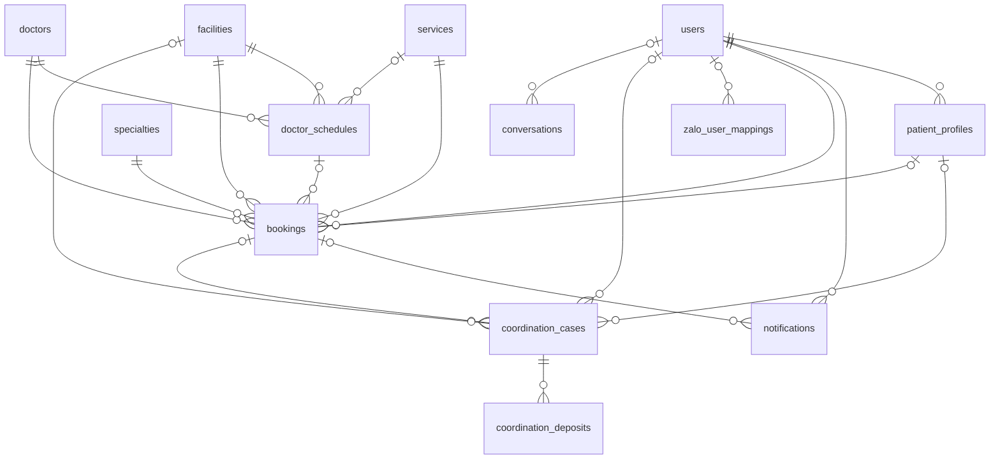
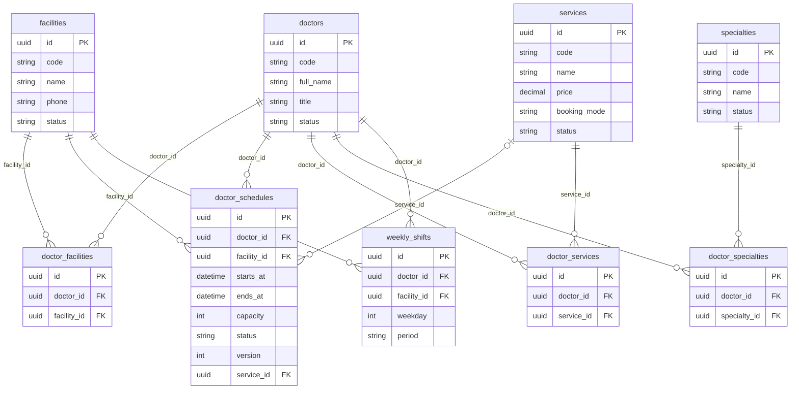
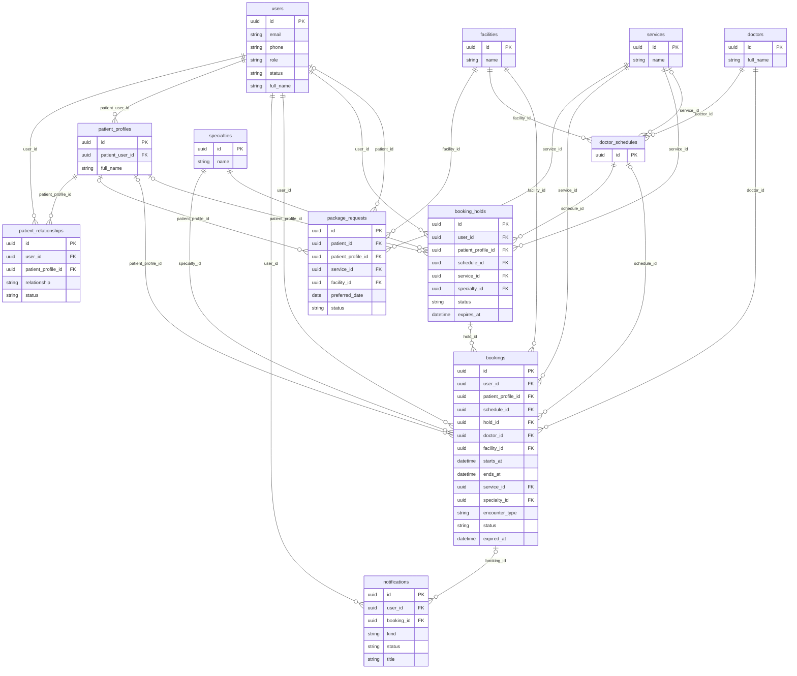
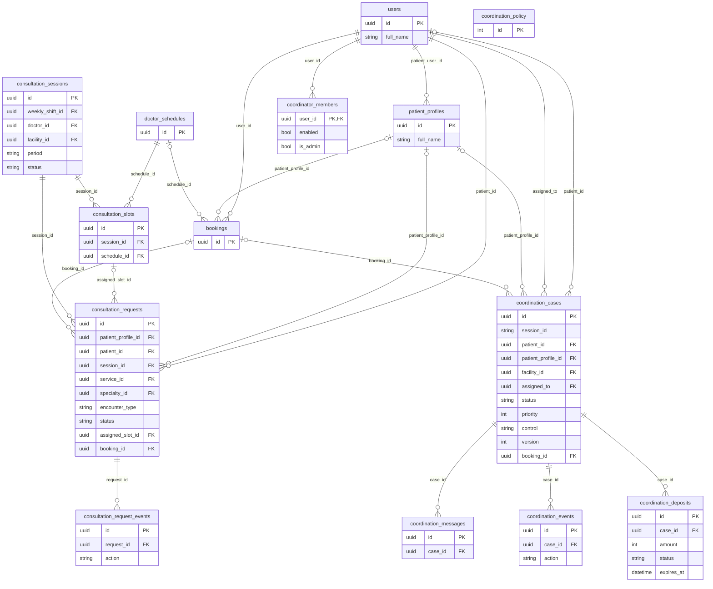
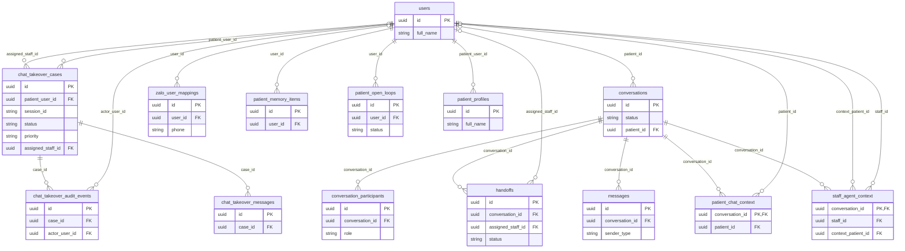

# Sơ đồ quan hệ dữ liệu (ERD) — VCare+ (P-124)

> Căn cứ: `develop` commit `d867dfd` (11/10/2026). Sơ đồ được **sinh tự động** từ metadata của model SQLAlchemy (`src/models/`), nên tên cột, khóa và quan hệ khớp đúng với code.
> Danh sách đầy đủ 43 bảng và 91 khóa ngoại: [schema-overview.md](schema-overview.md).

## Đọc sơ đồ thế nào

Mỗi ô là một **bảng**. Các dòng trong ô là **cột**, cột `PK` là khóa chính, cột `FK` là khóa ngoại trỏ sang bảng khác.

Đường nối giữa hai bảng cho biết **một bản ghi bên này ứng với bao nhiêu bản ghi bên kia**. Ký hiệu nằm ở hai đầu đường nối:

| Ký hiệu ở đầu đường | Nghĩa |
|---|---|
| `\|\|` (hai vạch) | Đúng **một** |
| `o\|` (vòng + vạch) | **Không hoặc một** |
| `o{` (vòng + chân chim) | **Không, một hoặc nhiều** |

Ví dụ `doctors ||--o{ bookings`: một bác sĩ có thể có **nhiều** lịch hẹn, mỗi lịch hẹn thuộc **đúng một** bác sĩ. Nếu đầu phía bảng cha là `o|`, khóa ngoại được phép để trống (ví dụ lịch hẹn có thể không gắn giữ chỗ `hold_id`).

Chữ trên đường nối là **tên cột khóa ngoại** ở bảng con.

## Quy ước rút gọn để sơ đồ dễ đọc

- Chỉ hiện khóa chính, khóa ngoại và vài cột quan trọng (trạng thái, tên, thời gian…). Danh sách cột đầy đủ xem ở từ điển dữ liệu.
- Bảng đã vẽ chi tiết ở sơ đồ khác chỉ hiện khóa chính và tên.
- **Ẩn 16 khóa ngoại "ghi vết"** (cho biết *ai* tạo, duyệt, thao tác), vì chúng đều trỏ về `users` và làm sơ đồ rối:

  `booking_holds.requested_by_user_id`, `bookings.requested_by_user_id`, `bookings.reviewed_by`, `catalog_audit_events.actor_id`, `chat_takeover_messages.author_user_id`, `consultation_request_events.actor_id`, `consultation_requests.requested_by_user_id`, `consultation_requests.reviewed_by`, `coordination_cases.requested_by_user_id`, `coordination_deposits.verified_by`, `coordination_events.actor_id`, `coordination_messages.actor_id`, `doctor_schedules.created_by`, `doctor_schedules.updated_by`, `package_requests.requested_by_user_id`, `patient_profiles.linked_user_id` (tất cả trỏ về `users.id`).

## Những điểm cần nắm

1. **`users` là trung tâm**, được 39 khóa ngoại trỏ tới. Cả bệnh nhân lẫn nhân viên đều là một dòng trong `users`, phân biệt bằng cột `role`.
2. **Bệnh nhân và hồ sơ khám là hai khái niệm khác nhau.** Một tài khoản (`users`) có thể quản lý nhiều **hồ sơ người khám** (`patient_profiles`), ví dụ đặt lịch cho bố mẹ, con. Lịch hẹn ghi cả `user_id` (ai đặt) lẫn `patient_profile_id` (khám cho ai).
3. **Bác sĩ liên kết nhiều–nhiều** với chuyên khoa, cơ sở, dịch vụ qua 3 bảng trung gian `doctor_specialties`, `doctor_facilities`, `doctor_services`.
4. **Có 2 cơ chế đặt lịch**: lịch đặt trực tiếp (`bookings` + `booking_holds`) và ca điều phối (`coordination_cases`). Khi điều phối viên chốt lịch, ca gắn với một `bookings` qua `coordination_cases.booking_id`.
5. **Có 2 hệ thống tiếp quản chat** song song: `chat_takeover_*` và bộ `conversations` / `handoffs`.

## 0. Tổng quan

Các bảng nghiệp vụ chính và quan hệ giữa chúng: không hiện cột và khóa ngoại ghi vết; giữ chỗ, tin nhắn, gói khám được vẽ chi tiết ở sơ đồ 2 và 4.

## 1. Danh mục & lịch bác sĩ

Danh mục y tế và lịch làm việc. Bác sĩ liên kết nhiều-nhiều với chuyên khoa, cơ sở, dịch vụ qua 3 bảng trung gian.

## 2. Người dùng & đặt lịch

Bệnh nhân, hồ sơ người thân, giữ chỗ, lịch hẹn, yêu cầu gói khám và thông báo.

## 3. Điều phối (HITL Workbench) & lịch tư vấn

Ca điều phối và mọi thứ gắn với ca: sự kiện, tin nhắn, tiền cọc. Kèm luồng yêu cầu tư vấn theo phiên.

## 4. Hội thoại, tiếp quản & bộ nhớ

Hội thoại hợp nhất (web, Zalo, nhân viên), tiếp quản chat và bộ nhớ dài hạn của bệnh nhân.

## Bảng không có trong sơ đồ

| Bảng | Lý do |
|---|---|
| `catalog_audit_events` | Nhật ký thay đổi danh mục; chỉ trỏ về `users` (người thao tác) |
| `chat_conversations`, `chat_turns` | Không có model ORM (truy cập bằng SQL thuần trong `src/services/chat_history.py`), nên không sinh được từ metadata. `chat_turns.conversation_id` → `chat_conversations.id` |

> ⚠️ 11 bảng trong sơ đồ 2 và 4 (`patient_profiles`, `patient_relationships`, `package_requests`, `conversations`, `conversation_participants`, `messages`, `handoffs`, `patient_chat_context`, `staff_agent_context`, `patient_memory_items`, `patient_open_loops`) **không được migration Alembic tạo ra**. Chi tiết và đề xuất xử lý: [schema-overview.md](schema-overview.md#️-lệch-giữa-model-và-migration).
