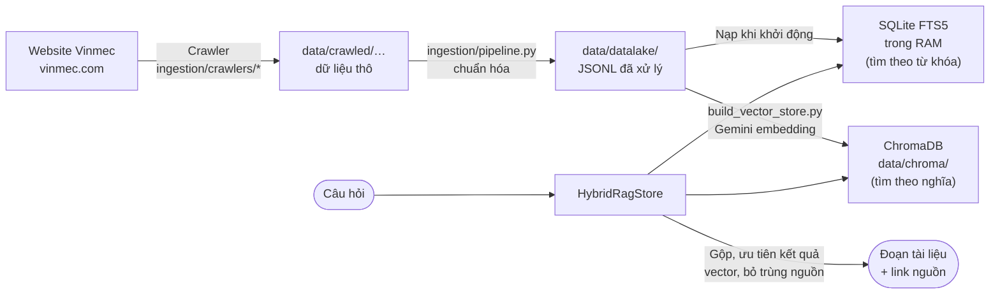

# Dữ liệu cho RAG — VCare+ (P-124)

> Dữ liệu tri thức mà trợ lý AI tra cứu: lấy từ đâu, nằm ở đâu, được đánh chỉ mục thế nào, và cách dựng lại.
> Căn cứ: `develop` commit `69e5833` (12/10/2026). Code: `src/medical_assistant/rag/`, `src/medical_assistant/ingestion/`, `scripts/build_vector_store.py`. Xem thêm: `docs/vector-db.md`.

## 1. Tổng quan

RAG (Retrieval-Augmented Generation) cho AI **tra cứu tài liệu trước rồi mới trả lời**, để câu trả lời về khoa, dịch vụ, bệnh viện dựa trên dữ liệu thật thay vì tự bịa.

VCare+ dùng **Hybrid RAG**: hai cách tìm chạy song song rồi gộp kết quả.



| Thành phần | Công nghệ | Lưu ở đâu | Cần gì để chạy |
|---|---|---|---|
| Tìm theo **từ khóa** | SQLite FTS5 | **Trong RAM**, dựng lại từ file JSONL mỗi lần khởi động | Chỉ cần file JSONL |
| Tìm theo **nghĩa** | ChromaDB, collection `vinmec_medical_rag` | Thư mục `data/chroma/` (`CHROMA_PERSIST_DIR`) | File JSONL + `GOOGLE_AI_API_KEY` (gọi Gemini embedding cả lúc dựng lẫn lúc tìm) |
| Gộp kết quả | `HybridRagStore` (`rag/store_cache.py`) | — | Nếu ChromaDB lỗi hoặc trống thì **tự chạy chỉ với FTS** |

**Ai dùng RAG:** `domain/guardrail_service.py` (trả lời thông tin về khoa) và `agent/tools/disease_tools.py` (tra cứu kiến thức bệnh).

## 2. Nguồn dữ liệu

Toàn bộ dữ liệu được **crawl từ website công khai của Vinmec** bằng các crawler trong `src/medical_assistant/ingestion/crawlers/`. Crawler đọc `robots.txt` và chờ 2 giây giữa các request.

| Crawler | Nguồn | Dữ liệu |
|---|---|---|
| `doctors` | `vinmec.com/vie/chuyen-gia-y-te/`, `vinmec.com/eng/professionals/` | Hồ sơ bác sĩ |
| `specialties` | Trang chuyên khoa Vinmec | Mô tả chuyên khoa |
| `services` | Trang dịch vụ / gói khám | Dịch vụ, giá |
| `hospitals` | Trang bệnh viện / phòng khám | Cơ sở, địa chỉ |
| `diseases` | `sitemap/diseases-vi-1.xml` + mục lục A–Z `vinmec.com/vie/benh/` | Kiến thức bệnh |

Chạy crawler (từ thư mục gốc):

```bash
python -m src.medical_assistant.ingestion.crawlers.doctors
python -m src.medical_assistant.ingestion.crawlers.specialties
python -m src.medical_assistant.ingestion.crawlers.services
python -m src.medical_assistant.ingestion.crawlers.hospitals --language vi
python -m src.medical_assistant.ingestion.crawlers.diseases
python -m src.medical_assistant.ingestion.pipeline     # gom kết quả vào data/datalake/ + ghi manifest.json
```

> ⚠️ README của một số crawler (`doctors`, `specialties`) còn ghi đường dẫn module cũ `src.data.crawlers_*`, không còn tồn tại. Dùng đường dẫn `src.medical_assistant.ingestion.crawlers.*` như trên.

## 3. Các file dữ liệu

| File | Dùng cho | Có trong git? | Kích thước |
|---|---|---|---|
| `data/datalake/rag/specialties.jsonl` | FTS + ChromaDB | ✅ Có | 341 đoạn, 1,3 MB |
| `data/datalake/normalized/diseases_triaged.jsonl` | Phân loại cấp cứu / định tuyến bệnh (`triage_service.py`, `disease_tools.py`), bản dự phòng đồng bộ từ bảng Supabase `disease_triage` | ✅ Có | 741 bệnh, 956 KB |
| `data/crawled/doctors/processed/jsonl/vinmec_professionals_vi.jsonl` | Dự phòng tìm bác sĩ khi không kết nối được database (`doctor_schedule_service.py`) | ✅ Có | 992 bác sĩ, 5,8 MB |
| `data/datalake/rag/doctors.jsonl` | FTS | ❌ Không | — |
| `data/datalake/rag/disease_education.jsonl` | FTS + ChromaDB | ❌ Không | — |
| `data/datalake/rag/services.jsonl` | ChromaDB | ❌ Không | — |
| `data/datalake/normalized/hospitals.jsonl` | FTS | ❌ Không | — |
| `data/datalake/rag/symptom_specialty_mapping.jsonl` | FTS | ❌ Không | — |
| `data/datalake/rag/specialty_facilities.jsonl` | FTS | ❌ Không | — |
| `data/chroma/` | ChromaDB (vector đã tính) | ❌ Không | — |

`.gitignore` (dòng 34–51) chặn `data/` nhưng mở ngoại lệ cho đúng 3 file ✅ ở trên. Tuy nhiên dòng 103 lại có `data/` (chặn cả thư mục), làm các ngoại lệ đó **mất tác dụng với file mới**: 3 file trên vẫn được theo dõi chỉ vì đã commit từ trước; muốn thêm file dữ liệu mới vào git phải dùng `git add -f` hoặc bỏ dòng 103.

**Định dạng một đoạn tài liệu (JSONL, mỗi dòng một đoạn):**

```json
{
  "chunk_id": "vinmec-specialty-cap-cuu-vi-overview-1-1",
  "text": "# Cấp cứu\n- Language: vi\n\n## Tổng quan\n\n### Hoạt động 24/7 ...",
  "metadata": { "name": "Cấp cứu", "source_url": "https://www.vinmec.com/...", "category": "specialty", "section": "overview", "language": "vi" }
}
```

`source_url` được giữ lại để câu trả lời **trích nguồn** (ràng buộc grounded của đề bài).

## 4. Dựng lại vector store (ChromaDB)

```bash
# 1. Đặt GOOGLE_AI_API_KEY trong .env (tùy chọn: CHROMA_PERSIST_DIR, mặc định ./data/chroma)
# 2. Từ thư mục gốc:
python scripts/build_vector_store.py                 # thêm các đoạn chưa có (bỏ qua chunk_id đã index)
python scripts/build_vector_store.py --rebuild       # xóa collection rồi dựng lại từ đầu
python scripts/build_vector_store.py --batch-size 20 # giảm lô nếu bị giới hạn tốc độ (mặc định 30)
# 3. Khởi động lại backend để HybridRagStore nhận chỉ mục mới
```

| Thông số | Giá trị |
|---|---|
| Model embedding | `models/gemini-embedding-001` (Google AI) |
| Nguồn đầu vào | `specialties.jsonl`, `disease_education.jsonl`, `services.jsonl`; file nào thiếu thì bỏ qua |
| Thử lại khi lỗi | Tối đa 8 lần, có chờ tăng dần khi bị giới hạn tốc độ (HTTP 429) |
| Chi phí | Mỗi đoạn gọi 1 lần embedding, tốn quota Gemini |

**Tự động khi khởi động:** `src/main.py` gọi `ensure_vector_index()` ở chế độ nền. Nếu có `GOOGLE_AI_API_KEY`, app tự index các đoạn còn thiếu; không có key thì bỏ qua và chạy chỉ với FTS.

**Chuyển chỉ mục sang máy khác:** dừng backend, chép **toàn bộ** thư mục `data/chroma/` (không chỉ file `chroma.sqlite3`), dùng cùng phiên bản ChromaDB và cùng model embedding.

## 5. ⚠️ Lưu ý và rủi ro

| # | Vấn đề | Ảnh hưởng | Đề xuất |
|---|---|---|---|
| 1 | Git chỉ có 1/6 file mà FTS cần (`specialties.jsonl`) | Bản clone mới hoặc server mới chỉ tra cứu được **thông tin chuyên khoa**; không có dữ liệu bệnh viện, bác sĩ, ánh xạ triệu chứng → khoa trong RAG | Lưu 5 file còn lại ở nơi dùng chung (Google Drive của nhóm, bucket S3) kèm hướng dẫn tải; hoặc commit nếu dung lượng cho phép |
| 2 | `docker-compose.yml` mount `./data` của server **đè lên** `/app/data` trong image | Nếu thư mục `data/` trên server trống, các file JSONL đã đóng gói trong image **bị che mất**, RAG và dữ liệu dự phòng không có gì để đọc | Kiểm tra `/opt/app/data` trên EC2; chép đủ file dữ liệu lên server, hoặc chỉ mount `data/chroma/` |
| 3 | Index vector cần quota Gemini | Mỗi lần dựng lại từ đầu tốn quota; key hết hạn mức thì app tự lùi về FTS | Giữ `data/chroma/` trên ổ lưu trữ bền, không dựng lại mỗi lần deploy |
| 4 | Dữ liệu crawl từ website Vinmec | Cần tôn trọng điều khoản sử dụng của website; dữ liệu có thể lỗi thời | Ghi rõ nguồn và thời điểm crawl (đã có `crawled_at` trong file); chỉ dùng cho mục đích demo / học tập |
| 5 | README crawler ghi sai đường dẫn module | Người mới chạy theo README sẽ lỗi | Sửa README trong `src/medical_assistant/ingestion/crawlers/*/README.md` |
