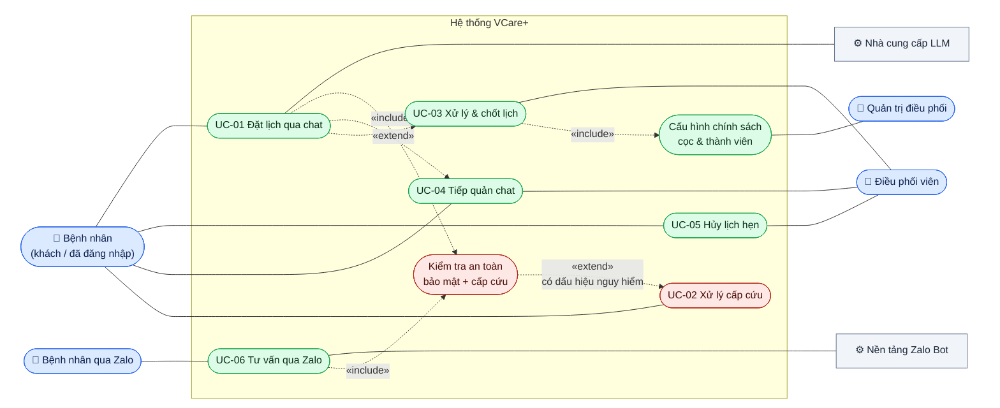

# Use Cases — VCare+ (P-124)

> 6 use case chính của hệ thống, mô tả theo luồng chính, luồng thay thế và ngoại lệ.
> Căn cứ: code nhánh `develop` (commit `42c909e`, 10/10/2026). Mã yêu cầu (FR) và story (US) tham chiếu tới [functional-requirements.md](functional-requirements.md) và [user-stories.md](user-stories.md).

| Mã | Use case | Tác nhân chính | FR liên quan |
|---|---|---|---|
| UC-01 | Đặt lịch qua chat | Bệnh nhân (khách hoặc đã đăng nhập) | FR-08 → FR-12, FR-23 → FR-26 |
| UC-02 | Xử lý tình huống cấp cứu | Bệnh nhân | FR-17 → FR-19 |
| UC-03 | Điều phối viên xử lý và chốt lịch | Điều phối viên | FR-32 → FR-40 |
| UC-04 | Tiếp quản cuộc trò chuyện | Điều phối viên, Bệnh nhân | FR-33, FR-37, FR-45 |
| UC-05 | Hủy lịch hẹn | Bệnh nhân, Điều phối viên | FR-30, FR-35, FR-39 |
| UC-06 | Tư vấn qua Zalo | Bệnh nhân qua Zalo | FR-46 → FR-48 |

## Sơ đồ use case

Mermaid chưa có loại sơ đồ use case riêng, nên sơ đồ dưới dùng `flowchart`: hình người là tác nhân (bệnh nhân bên trái, nhân viên và hệ thống ngoài bên phải), hình bo tròn là use case, mũi tên nét đứt là quan hệ giữa các use case:
- UC-01 và UC-06 luôn **«include»** bước kiểm tra an toàn; bước này **«extend»** sang UC-02 khi có dấu hiệu nguy hiểm.
- UC-01 **«extend»** sang UC-04 khi bệnh nhân xin gặp người thật, và tạo ca cho UC-03 xử lý.
- Ô màu đỏ là phần an toàn lâm sàng.

---

## UC-01. Đặt lịch qua chat

| Mục | Nội dung |
|---|---|
| **Tác nhân chính** | Bệnh nhân khách hoặc bệnh nhân đã đăng nhập |
| **Tác nhân phụ** | AI Agent, nhà cung cấp LLM, Điều phối viên (nhận ca ở UC-03) |
| **Mục tiêu** | Từ mô tả triệu chứng bằng lời thường đến khi có một yêu cầu đặt lịch nằm trong hàng đợi điều phối |
| **Tiền điều kiện** | Bệnh nhân khách đã khai họ tên + số điện thoại, hoặc bệnh nhân đã đăng nhập |
| **Hậu điều kiện (thành công)** | Một **ca điều phối** được tạo, bệnh nhân nhận mã yêu cầu; lịch **chưa** được xác nhận |

**Luồng chính**

1. Bệnh nhân mô tả triệu chứng trong khung chat.
2. Hệ thống kiểm tra bảo mật đầu vào và kiểm tra dấu hiệu cấp cứu (không phải cấp cứu → tiếp tục).
3. Agent hỏi làm rõ từng câu một (vị trí, thời gian, mức độ…), không hỏi lại điều đã biết.
4. Bệnh nhân trả lời; lặp lại bước 3 cho đến khi đủ thông tin.
5. Agent gợi ý chuyên khoa có trong danh mục, kèm khuyến cáo y tế.
6. Agent tìm bác sĩ phù hợp và khung giờ đã được database xác minh, gợi ý cơ sở theo khu vực nếu bệnh nhân nêu.
7. Bệnh nhân đồng ý đặt lịch; hệ thống hiển thị form với các thông tin AI đã trích xuất từ hội thoại.
8. Bệnh nhân kiểm tra/sửa họ tên, số điện thoại, ngày sinh, ngày khám mong muốn, tick **đồng ý cho điều phối viên liên hệ** và gửi.
9. Hệ thống kiểm tra dữ liệu và tạo ca điều phối trong hàng đợi.
10. Hệ thống trả về mã yêu cầu và thông báo: đây chưa phải lịch đã xác nhận, điều phối viên sẽ liên hệ.

**Luồng thay thế**

- **A1. Bệnh nhân đã đăng nhập (bước 1):** hệ thống nạp lịch sử hội thoại và hồ sơ sức khỏe để cá nhân hóa; các trường form điền sẵn từ hồ sơ.
- **A2. Đặt cho người thân (bước 8):** bệnh nhân chọn một hồ sơ người thân đã lưu.
- **A3. Người khám dưới 18 tuổi (bước 8):** hệ thống yêu cầu thêm họ tên và số điện thoại người giám hộ.
- **A4. Chưa có khung giờ được xác minh (bước 6):** agent nói rõ chưa có lịch trống được xác minh, chỉ hiển thị hồ sơ bác sĩ có nguồn; bệnh nhân vẫn gửi được yêu cầu để điều phối viên sắp xếp.
- **A5. Bệnh nhân hỏi chẩn đoán hoặc xin thuốc (bất kỳ bước nào):** agent từ chối, giải thích và quay lại hướng chuyên khoa.
- **A6. Bệnh nhân muốn gặp người thật (bất kỳ bước nào):** chuyển sang UC-04.

**Ngoại lệ**

- **E1. Phát hiện dấu hiệu cấp cứu (bước 2 hoặc bước 4):** chuyển sang UC-02, không cho đặt lịch thường.
- **E2. Không tick đồng ý liên hệ (bước 9):** hệ thống từ chối (422) "Cần đồng ý để điều phối viên liên hệ".
- **E3. Dữ liệu không hợp lệ (bước 9):** họ tên dưới 2 ký tự, số điện thoại không phải số Việt Nam, ngày sinh trong tương lai, ngày khám trong quá khứ hoặc quá 90 ngày → từ chối (422) kèm lý do.
- **E4. Nội dung tấn công (bước 2):** tin nhắn bị chặn, agent trả lời an toàn và không gọi LLM.
- **E5. Nhà cung cấp LLM lỗi hoặc quá thời gian:** hệ thống chuyển sang nhà cung cấp dự phòng; nếu tất cả đều lỗi, trả câu trả lời dự phòng an toàn bằng luật.

---

## UC-02. Xử lý tình huống cấp cứu

| Mục | Nội dung |
|---|---|
| **Tác nhân chính** | Bệnh nhân |
| **Tác nhân phụ** | AI Agent; Điều phối viên (thấy ca ưu tiên cao trong hàng đợi) |
| **Mục tiêu** | Bệnh nhân có dấu hiệu nguy hiểm được hướng dẫn gọi 115 / đến cấp cứu ngay, không bị dẫn vào quy trình đặt lịch |
| **Tiền điều kiện** | Bệnh nhân đang trong phiên chat |
| **Hậu điều kiện** | Phiên được đánh dấu cấp cứu (`is_emergency`, mức ATS 1–2); không có lịch thường nào được tạo cho phiên này |

**Luồng chính**

1. Bệnh nhân gửi tin nhắn có dấu hiệu nguy hiểm (ví dụ "tức ngực, khó thở, vã mồ hôi").
2. Hệ thống đối chiếu tin nhắn với bộ luật cấp cứu **trước khi gọi LLM**.
3. Luật khớp: hệ thống gán mức ATS và chuyển thẳng tới bước trả lời, bỏ qua bước tìm bác sĩ/lịch.
4. Hệ thống hiển thị cảnh báo cấp cứu: gọi **115** hoặc đến phòng cấp cứu gần nhất, không chờ lịch hẹn; kèm nút gọi 115 và khuyến cáo y tế.

**Luồng thay thế**

- **A1. Dấu hiệu xuất hiện sau vài lượt (bước 1):** hệ thống đánh giá lại trên toàn bộ triệu chứng đã thu thập; khi tổng hợp đủ dấu hiệu nguy hiểm thì chuyển sang bước 3.
- **A2. Ca đang do người thật tiếp quản (bước 2):** kiểm tra cấp cứu vẫn chạy trước, cảnh báo vẫn hiển thị cho bệnh nhân.
- **A3. Câu hỏi chẩn đoán có kèm dấu hiệu nguy hiểm** (ví dụ "đau ngực dữ dội có phải bệnh tim không?"): ưu tiên xử lý cấp cứu, không xử lý như câu hỏi chẩn đoán.

**Ngoại lệ**

- **E1. Bệnh nhân vẫn cố gửi yêu cầu đặt lịch cho phiên cấp cứu:** hệ thống từ chối (409) "Ca có dấu hiệu cấp cứu không được chuyển sang đặt lịch thường".
- **E2. Câu phủ định** (ví dụ "không khó thở"): hệ thống không coi là dấu hiệu, không báo động sai.

> **Hạn chế hiện tại:** cảnh báo mất 7,9–14,8 giây mới hiển thị (NFR-11), và một số nhãn bệnh hiển thị sai (NFR-07).

---

## UC-03. Điều phối viên xử lý và chốt lịch

| Mục | Nội dung |
|---|---|
| **Tác nhân chính** | Điều phối viên |
| **Tác nhân phụ** | Bệnh nhân, Quản trị (cấu hình chính sách cọc) |
| **Mục tiêu** | Biến một yêu cầu đặt lịch thành lịch hẹn đã xác nhận, có người thật kiểm soát (HITL) |
| **Tiền điều kiện** | Điều phối viên đăng nhập, đang trực; có ca trong hàng đợi (từ UC-01) |
| **Hậu điều kiện (thành công)** | Lịch hẹn được tạo ở trạng thái đã xác nhận, bệnh nhân được thông báo, nhắc lịch được lên lịch |

**Luồng chính**

1. Điều phối viên mở hàng đợi; hệ thống chỉ hiển thị ca thuộc cơ sở được phân công, ca cấp cứu đứng đầu.
2. Điều phối viên nhận ca (claim). Ca được gán cho người này và chuyển sang `contacting`.
3. Điều phối viên xem bối cảnh AI: tóm tắt hội thoại, triệu chứng, chuyên khoa gợi ý, mức ưu tiên.
4. Điều phối viên liên hệ bệnh nhân, thống nhất phương án: chuyên khoa, dịch vụ, khung giờ cụ thể.
5. Điều phối viên lưu phương án và ghi nhận bệnh nhân đã đồng ý. Hệ thống kiểm tra khung giờ còn hợp lệ, thuộc phạm vi cơ sở, và giữ chỗ.
6. Điều phối viên tạo yêu cầu đặt cọc. Bệnh nhân nhận thông báo kèm hướng dẫn thanh toán.
7. Bệnh nhân chuyển cọc; điều phối viên xác minh đã nhận cọc.
8. Điều phối viên chốt lịch. Hệ thống kiểm tra cọc đã xác minh và khung giờ vẫn hợp lệ, rồi tạo lịch hẹn đã xác nhận.
9. Bệnh nhân nhận thông báo lịch đã xác nhận; hệ thống tự nhắc lịch trước ngày khám.

**Luồng thay thế**

- **A1. Lịch bệnh nhân tự đặt trên web:** điều phối viên mở trang duyệt lịch, xem lịch `pending_approval` và chọn xác nhận hoặc từ chối (kèm ghi chú). Bệnh nhân được thông báo.
- **A2. Nhận / từ chối hàng loạt (bước 2):** chọn tối đa 100 ca và thao tác một lần.
- **A3. Hẹn theo dõi (bước 4):** bệnh nhân chưa quyết định, điều phối viên đặt mốc liên hệ lại.
- **A4. Bàn giao (bất kỳ bước nào):** điều phối viên bàn giao ca cho đồng nghiệp hoặc bàn giao toàn bộ ca khi hết ca trực (bắt buộc có ghi chú).
- **A5. Cần nói chuyện trực tiếp trong chat (bước 4):** chuyển sang UC-04.

**Ngoại lệ**

- **E1. Ca đã có người khác nhận (bước 2):** từ chối (409) "Ca đã có người phụ trách".
- **E2. Hai người sửa cùng lúc:** phiên bản (`version`) không khớp → từ chối, yêu cầu tải lại ca.
- **E3. Khung giờ không hợp lệ hoặc ngoài phạm vi cơ sở (bước 5):** phương án bị từ chối.
- **E4. Quản trị chưa cấu hình chính sách cọc (bước 6):** từ chối (409), cần quản trị cấu hình trước.
- **E5. Chưa thống nhất phương án mà đã yêu cầu cọc (bước 6):** từ chối (409).
- **E6. Chốt lịch khi chưa xác minh cọc (bước 8):** từ chối (409) "Cần xác minh cọc trước khi chốt lịch".
- **E7. Cọc quá hạn:** hệ thống tự cho cọc hết hiệu lực.
- **E8. Lịch tự đặt quá hạn duyệt (A1):** tác vụ nền chuyển lịch sang `expired`, bệnh nhân được thông báo.

---

## UC-04. Tiếp quản cuộc trò chuyện

| Mục | Nội dung |
|---|---|
| **Tác nhân chính** | Điều phối viên |
| **Tác nhân phụ** | Bệnh nhân, AI Agent |
| **Mục tiêu** | Người thật thay AI trò chuyện trực tiếp với bệnh nhân trong những ca AI không xử lý tốt |
| **Tiền điều kiện** | Ca có phiên chat (`session_id`); điều phối viên đang phụ trách ca |
| **Hậu điều kiện** | Ca được xử lý bởi người thật; khi trả lại, AI tiếp tục với bản tóm tắt bàn giao |

**Luồng chính**

1. Ca xuất hiện trong hàng đợi (từ yêu cầu gặp người thật, ca cấp cứu, hoặc điều phối viên chủ động chọn).
2. Điều phối viên nhận ca và chọn **tiếp quản** (takeover). Quyền điều khiển phiên chuyển sang người thật.
3. Bệnh nhân gửi tin nhắn. AI **không** trả lời nữa; bệnh nhân thấy thông báo đang chờ nhân viên.
4. Điều phối viên nhận tin nhắn theo thời gian thực và trả lời trực tiếp.
5. Khi xong, điều phối viên **trả quyền cho AI** (resume) kèm ghi chú tóm tắt.
6. AI tiếp tục phiên chat, dùng ghi chú bàn giao làm ngữ cảnh.

**Luồng thay thế**

- **A1. Bệnh nhân chủ động yêu cầu gặp người thật (bước 1):** bệnh nhân bấm yêu cầu; ca được đưa vào hàng đợi.
- **A2. Kết thúc luôn (bước 5):** điều phối viên hoàn tất ca thay vì trả lại cho AI.

**Ngoại lệ**

- **E1. Ca không có hội thoại (bước 2):** từ chối (409) "Ca này không có hội thoại".
- **E2. Ca đã đóng:** các thao tác trên ca bị từ chối (409) "Ca đã đóng".
- **E3. Bệnh nhân gửi dấu hiệu cấp cứu khi đang tiếp quản (bước 3):** kiểm tra cấp cứu vẫn chạy và cảnh báo 115 vẫn hiển thị (UC-02, A2).

---

## UC-05. Hủy lịch hẹn

| Mục | Nội dung |
|---|---|
| **Tác nhân chính** | Bệnh nhân hoặc Điều phối viên |
| **Mục tiêu** | Hủy lịch hẹn, trả chỗ cho người khác, xử lý tiền cọc nếu có |
| **Tiền điều kiện** | Lịch hẹn / ca điều phối tồn tại và chưa đóng |
| **Hậu điều kiện** | Lịch ở trạng thái `cancelled` (không xóa dữ liệu), nhắc lịch bị hủy, cọc được xử lý |

**Luồng chính (bệnh nhân hủy)**

1. Bệnh nhân mở chi tiết lịch hẹn và chọn hủy, có thể ghi lý do.
2. Hệ thống kiểm tra lịch chưa bị hủy và chưa bị từ chối.
3. Hệ thống chuyển lịch sang `cancelled`, lưu lý do, bỏ các nhắc lịch còn chờ.
4. Ca điều phối liên quan được đồng bộ: cọc đã xác minh chuyển sang `refund_pending`, cọc chưa nộp chuyển sang `voided`.
5. Điều phối viên xác nhận đã hoàn cọc (nếu có).

**Luồng thay thế**

- **A1. Điều phối viên hủy ca:** điều phối viên chọn hủy trên ca. Hệ thống giải phóng chỗ giữ, xử lý cọc như bước 4, hủy lịch hẹn gắn với ca và trả quyền chat về AI.
- **A2. Đổi lịch thay vì hủy:** bệnh nhân chọn khung giờ khác; lịch quay về `pending_approval` để được duyệt lại.
- **A3. Mở lại ca đã hủy:** điều phối viên mở lại ca nếu ca chưa gắn với lịch hẹn.

**Ngoại lệ**

- **E1. Lịch đã hủy:** từ chối (409) `BOOKING_ALREADY_CANCELLED`.
- **E2. Lịch đã bị từ chối:** từ chối (409) `BOOKING_NOT_CANCELLABLE`.
- **E3. Đổi lịch loại "thời gian mong muốn" (A2):** chưa hỗ trợ, từ chối (409) `BOOKING_NOT_RESCHEDULABLE`.

---

## UC-06. Tư vấn qua Zalo

| Mục | Nội dung |
|---|---|
| **Tác nhân chính** | Bệnh nhân qua Zalo |
| **Tác nhân phụ** | Nền tảng Zalo Bot, AI Agent |
| **Mục tiêu** | Tư vấn triệu chứng và tra lịch hẹn ngay trong Zalo, không cần mở web |
| **Tiền điều kiện** | Zalo Bot đã cấu hình token và chế độ webhook hoặc polling |
| **Hậu điều kiện** | Bệnh nhân nhận câu trả lời trong Zalo |

**Luồng chính**

1. Bệnh nhân nhắn tin cho Zalo Bot.
2. Nền tảng Zalo chuyển tin nhắn tới hệ thống (webhook hoặc polling).
3. Hệ thống tìm hoặc tạo liên kết giữa tài khoản Zalo và người dùng.
4. Tin nhắn được xử lý bởi cùng AI Agent như trên web (gồm kiểm tra cấp cứu, guardrail, hỏi làm rõ, gợi ý chuyên khoa).
5. Hệ thống gửi câu trả lời về Zalo, tự chia thành nhiều tin nếu dài hơn 1800 ký tự.

**Luồng thay thế**

- **A1. Hỏi lịch hẹn của tôi (bước 4):** nếu liên kết được với tài khoản web qua số điện thoại, bot trả về các lịch hẹn và ca điều phối gần nhất.

**Ngoại lệ**

- **E1. Không xác định được người dùng (A1):** chưa liên kết tài khoản và không có số điện thoại → bot không trả được lịch hẹn.
- **E2. Zalo Bot chưa cấu hình:** chế độ `disabled`, hệ thống không nhận tin nhắn Zalo.

> **Chưa có:** bot chưa tự gửi thông báo khi lịch được duyệt (hàm `send_zalo_notification_to_user` chưa được gọi).
